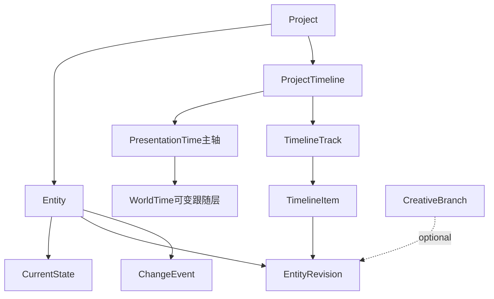
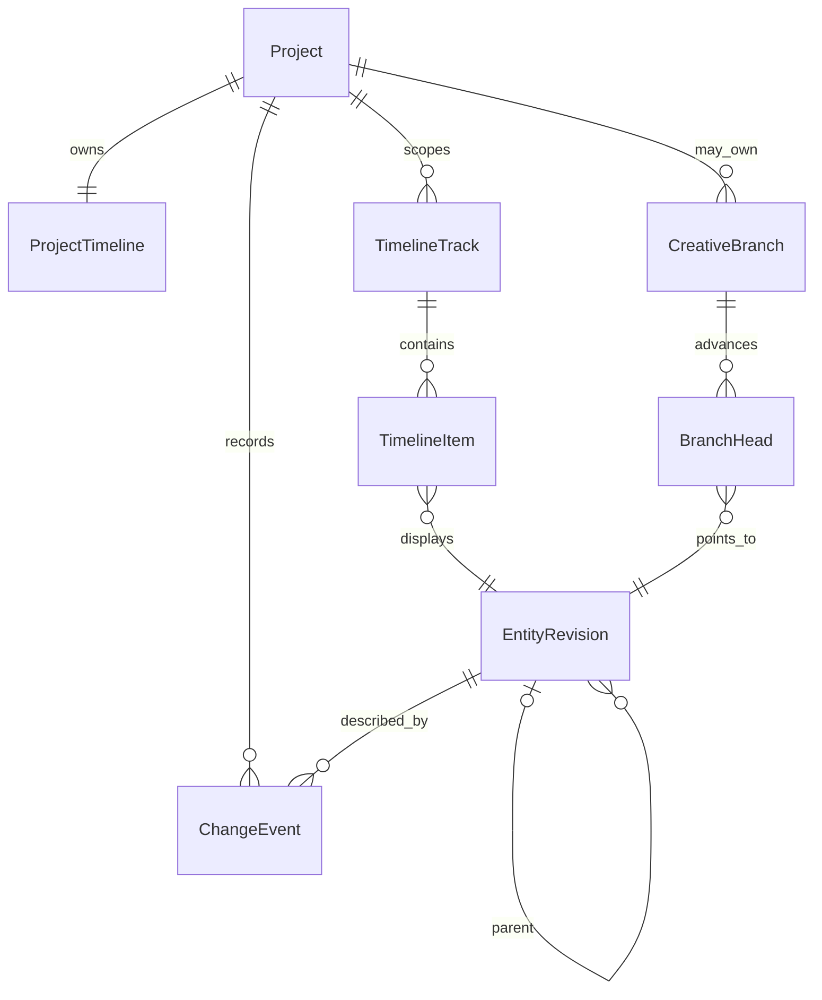
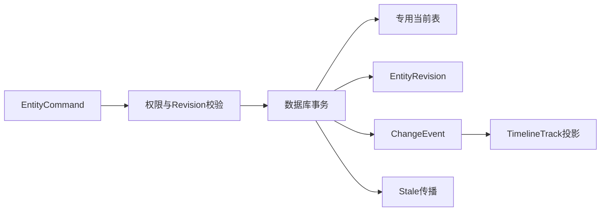

# Entity + State + Timeline + Track

> Zivith 世界创作状态与可变时间维度体系
>
> Status: Accepted design — revised 2026-07-29; H1–H3 on `feat/track-h-entity-history` (2026-07-30); Presentation Timeline UI not yet
>
> Scope: Domain architecture, presentation-led variable time model, API contract, UI boundary, and migration plan
>
> Decision: dedicated current-state tables + immutable State history; Timeline visualizes Entity State; Track is a semantic timeline lane
>
> Governance: [ADR-0007](adr/0007-preserve-current-state-with-immutable-creative-history.md) is Accepted; implementation proceeds on explicit Track H scheduling
>
> Implementation: H1 schemas; H2 tables + baseline; H3 `recordEntityChange` / flags default off — see [entity-history-write-paths.md](entity-history-write-paths.md)

---

## 1. 目的

Zivith 不是 Prompt → Video 工具，而是管理 IP 创作世界的 AI 原生创作 IDE：

```text
Create the world first. Produce the content second.

Prompt → World → Production → Video
```

本体系回答四个不同问题：

1. **Entity**：世界里有哪些具有持续身份的对象？
2. **State**：这些对象在某个时刻是什么样？
3. **Timeline**：如何以作品顺序为主轴，并叠加可变的世界时间关系？
4. **Track**：不同类型的 Entity State 如何分轨显示和编辑？

Timeline 是 Entity State 的可视化与编排视图，不是数据库审计日志。Track 是 Timeline 中的语义轨道，不是 Git 分支、Workflow 阶段、工程计划 Track 或视频 NLE 轨。

---

## 2. 核心概念

### 2.1 Entity：持续存在的世界对象

Entity 具有稳定 ID、Project 作用域、类型和生命周期。它的 State 可以变化，但身份不变。

#### 当前 Entity

| 领域 | Entity | 当前模型 |
|---|---|---|
| 世界 | Character | `Asset(type=character)` |
| 世界 | Location | `Asset(type=location)` |
| 叙事 | Story / StorySegment / Scene / Shot | 专用业务表 |
| 视觉 | AppearanceVariant / VisualRequirement | 专用业务表 |
| 产物 | PromptVersion / Output / Media | 专用业务表 |

#### 计划扩展 Entity

| Entity | 语义 | 首版策略 |
|---|---|---|
| Object | 道具、交通工具、关键物体 | 映射 `Asset(type=prop)`，先补齐 API/UI |
| Event | 世界内发生且可影响多个 Entity 的事件 | 新增独立 WorldEvent，不用 WorkflowEvent 代替 |
| Organization | 阵营、公司、门派、家庭等持续组织 | 新增 Project 级 Entity |
| Relationship | Entity 之间随时间变化的关系 | 先作为 Entity State 的结构化字段；需要独立查询时再提升为 Entity |

`WorkflowRun`、`WorkflowStep`、`Task` 是执行对象，不是世界 Entity。Provider 和 Model 是生成基础设施与 provenance，不成为世界 Entity。

统一逻辑引用：

```ts
interface EntityRef {
  project_id: string;
  entity_type: EntityType;
  entity_id: string;
}
```

逻辑引用不替代现有外键。服务层必须验证 Entity 存在且属于同一 Project。

### 2.2 State：当前状态 + 不可变历史

Entity State 描述某个 Entity 在一个确定 revision 上的业务状态。

以 Character 为例，State 可包含：

- 外貌与服装；
- 性格与心理；
- 声音；
- 能力与限制；
- 所属组织；
- 与其他 Entity 的关系；
- 可用与审批状态。

存储策略：

```text
Dedicated Current State + Immutable EntityRevision History
```

- 专用业务表仍是当前状态权威来源；
- `EntityRevision` 是历史状态权威来源；
- revision 单调递增、创建后不可修改；
- 大型媒体只保存 Media 引用，不复制二进制；
- approved Scene/Shot 与 Output 的冻结快照继续保留；
- 不采用完整 Event Sourcing，不从事件重建全部当前数据库。

State 不共享单一状态枚举。必须区分：

| 状态族 | 示例 | 含义 |
|---|---|---|
| Lifecycle | Asset `draft/active/archived` | 是否可被新创作引用 |
| Review | `draft/review/approved` | 是否经过创作决策 |
| Generation | Output `queued/generating/completed/failed` | 技术执行结果 |
| Freshness | `fresh/stale` | 上游变化是否令派生产物过期 |
| World State | alive/dead、young/old、alliance/hostile 等 | 作品世界内部状态 |

### 2.3 Timeline：作品时间主轴 + 可变世界时间维度

Project 提供一个统一 Timeline 工作区，同一画布可以按 Story、Scene、Entity 或 Track 过滤。**作品时间是唯一稳定主轴，World Time 默认跟随作品时间。**

#### Presentation Time（作品时间，主轴）

观众在具体 Story/成片中看到内容的顺序与持续时间：

- Scene/Shot 顺序；
- Shot 在作品中的起止秒数；
- 同一世界事件可被多个 Story 或 Shot 呈现。

```ts
interface PresentationTime {
  story_id: string;
  order: number;
  start_ms?: number;
  duration_ms?: number;
}
```

在尚无成片时，`order` 是权威；存在 Cut 后可增加毫秒坐标。Presentation Time 不是 Workflow 执行时间，也不使用 `created_at` 推断。

#### World Time（世界时间，跟随层）

World Time 不是独立、统一的全局时钟，而是附着在作品时间 Item 上的可变语义：

- 没有显式 World Time 时，默认 `follow` 当前 Presentation 顺序；
- 闪回声明相对某个 Item 的 `before`；
- 时间跳跃可以声明模糊值或范围；
- 虚构历法由 Project 自定义维度解释；
- 平行世界、梦境、模拟世界可使用不同时间维度；
- 跨越维度的 Item 可同时持有多个 binding。

Zivith **不标准化时间值本身**。系统只标准化最小信封，以便保存引用、关系和显示信息：

```ts
interface TemporalDimension {
  id: string;
  label: string;
  kind: 'calendar' | 'worldline' | 'dream' | 'simulation' | 'custom';
  parent_dimension_id?: string;
  schema?: JsonValue; // Project-defined; core does not interpret its calendar
}

interface WorldTimeBinding {
  dimension_id: string;
  mode: 'follow' | 'point' | 'range' | 'relative' | 'crossing' | 'unknown';
  value?: JsonValue;
  start?: JsonValue;
  end?: JsonValue;
  anchor_item_id?: string;
  relation?: 'before' | 'after' | 'same_as' | 'overlaps';
  label?: string;
  confidence?: 'exact' | 'approximate' | 'ambiguous';
}
```

`value/start/end` 对核心系统是不透明 JSON；对应维度的解释器负责显示和比较。完全不设信封会使引用、跨维关系和一致性检查不可实现，因此“不标准化”指不强制统一历法或标量，不是无结构存储。

#### 跟随不变量

- 首版 TimelineItem 必须有 Presentation Time；
- `world_time_bindings=[]` 表示跟随作品顺序，不重复存储 World Time；
- 显式 binding 只描述相对偏移、范围、模糊时间或维度跨越；
- 同一 EntityRevision 可在多个 Presentation 位置出现；
- 世界中尚未进入任何作品的 Entity 保留 State，但首版不进入 Timeline；
- 数据库提交时间属于 ChangeEvent，不属于创作时间；
- 时间标注变化不自动修改 Entity State。

### 2.4 Track：Timeline 的语义轨道

Track 按创作语义组织 TimelineItem。Track 不拥有 Entity，不创建平行真源。

#### 世界轨

| Track kind | 内容 |
|---|---|
| `scene` | 世界地点、环境或 Scene 的持续区间 |
| `character` | Character State 与出场区间 |
| `object` | Object 的持有、位置、损坏等状态 |
| `event` | WorldEvent 的发生与影响 |
| `organization` | Organization 状态、成员和关系变化 |

#### 作品轨

| Track kind | 内容 |
|---|---|
| `shot` | Story 中 Shot 顺序与持续时间 |
| `camera` | 从 Shot State 投影出的机位、镜头运动与构图 |
| `style` | 视觉风格、色彩与灯光区间 |
| `prompt` | PromptVersion 使用区间与批准状态 |
| `model` | 从 Output provenance 投影出的生成模型/配置，只读展示 |

`camera`、`style`、`prompt`、`model` 首选派生 Track：它们从 Shot、PromptVersion、Output 的 State 或 provenance 投影，避免重复存储。只有用户创建独立于现有 Entity 的规划片段时才保存显式 TimelineItem。

### 2.5 Branch：与 Track 分离的可选概念

替代创作方案仍有价值，但必须命名为 `CreativeBranch`，不能占用 Track：

- `main` 表示当前被接受的状态线；
- branch 保存替代 Entity revision head；
- compare/merge/abandon 属于 Branch 生命周期；
- branch 不直接修改当前业务表；
- Branch 属于后续能力，不阻塞 Entity + State 与 Timeline + Track。

---

## 3. 总体关系





---

## 4. 数据模型

### 4.1 EntityRevision

| 字段 | 类型 | 约束 |
|---|---|---|
| `id` | UUID | PK |
| `project_id` | UUID | Project 权限与分区键 |
| `entity_type/entity_id` | string/UUID | EntityRef |
| `revision` | int | `(entity_type, entity_id, revision)` 唯一 |
| `parent_revision_id` | UUID? | 直接父 revision |
| `branch_id` | UUID? | `null` 表示 main |
| `schema_version` | int | snapshot schema 版本 |
| `snapshot/snapshot_ref` | JSON/string | 恰有一个非空 |
| `snapshot_hash` | string | canonical JSON SHA-256 |
| `change_kind` | enum | baseline/create/update/transition/delete/restore/merge |
| `changed_fields` | string[] | JSON Pointer 路径 |
| `actor_id` | UUID? | 用户；系统可空 |
| `created_at` | timestamp | 不可变 |

### 4.2 ProjectTimeline

每个 Project 恰有一个 ProjectTimeline。它是统一工作区配置，不保存所有 Item 的大 JSON：

| 字段 | 类型 | 说明 |
|---|---|---|
| `project_id` | UUID | PK/FK |
| `temporal_dimensions` | JSON[] | Project 自定义时间维度；不强制统一历法 |
| `settings` | JSON | 显示密度、默认折叠等非领域偏好 |
| `version` | int | 乐观锁 |

### 4.3 TimelineTrack

| 字段 | 类型 | 说明 |
|---|---|---|
| `id` | UUID | PK |
| `project_id` | UUID | 必填 |
| `story_id` | UUID? | 作品轨通常绑定 Story；世界轨可为 Project 级 |
| `kind` | enum | scene/character/object/event/organization/shot/camera/style/prompt/model |
| `source` | enum | explicit/derived |
| `entity_id` | UUID? | Character/Object 等专属轨可绑定一个 Entity |
| `name` | string | UI 名称 |
| `order` | int | 同 scope 内显示顺序 |
| `collapsed/hidden` | boolean | 用户视图偏好 |
| `created_at/updated_at` | timestamp | 审计字段 |

派生 Track 可以不落库；若需要保存顺序和折叠偏好，只保存配置，不复制派生 Item。

### 4.4 TimelineItem

| 字段 | 类型 | 说明 |
|---|---|---|
| `id` | UUID | PK |
| `track_id` | UUID | 所属语义 Track |
| `entity_type/entity_id` | string/UUID | 展示的 Entity |
| `entity_revision_id` | UUID? | 固定 revision；为空表示跟随当前 State |
| `story_id` | UUID | Presentation scope |
| `presentation_order` | int | 无 Cut 时权威顺序 |
| `presentation_start_ms` | bigint? | 有 Cut 后可用 |
| `presentation_duration_ms` | bigint? | 可选 |
| `world_time_bindings` | JSON[] | 可选；为空即跟随 Presentation Time |
| `label` | string? | 局部显示名 |
| `metadata` | JSON | 仅视图数据，不放领域真源 |
| `version` | int | 乐观锁 |

Presentation Time 必填。`entity_revision_id` 固定时，后续 Entity 更新不改变该 Item 的历史显示；跟随当前 State 的 Item 必须在 UI 中明确标识。World Time binding 使用 Project 定义的 `dimension_id`，但核心数据库不解析其不透明时间值。

### 4.5 ChangeEvent

`ChangeEvent` 记录“系统中已提交了什么事实”，替代旧设计中的 `TimelineEvent` 命名，避免和创作 Timeline 混淆。

关键字段：

- Project 内单调 `sequence`；
- `event_type` 与 `schema_version`；
- Entity/Revision 引用；
- actor/source；
- correlation/causation；
- idempotency key；
- 小型 payload；
- `occurred_at/created_at`。

ChangeEvent 用于审计、通知、SSE 和因果追踪，但不直接作为 TimelineItem。投影器可以根据 ChangeEvent 更新派生 Track。

---

## 5. 一致性与写入

一次 main Entity 命令在同一事务中：

1. 校验 Project 权限与 `expected_revision`；
2. 运行领域状态转换；
3. 更新专用业务表；
4. append `EntityRevision`；
5. append `ChangeEvent`；
6. 标记受影响的非冻结下游 stale；
7. 事务提交后触发派生 Track 刷新/SSE。



命令统一携带：

```ts
interface EntityCommand<T> {
  project_id: string;
  entity: EntityRef;
  expected_revision: number;
  idempotency_key: string;
  payload: T;
}
```

- revision 不一致：`409 REVISION_CONFLICT`；
- 相同 key 与相同 payload：返回首次结果；
- 相同 key 与不同 payload：`409 IDEMPOTENCY_KEY_REUSED`；
- 缺少 revision：兼容期后返回 `428 PRECONDITION_REQUIRED`。

---

## 6. Timeline 解析与投影

### 6.1 世界轨投影

- Character Track：AppearanceVariant、Character State、WorldEvent 影响；
- Scene Track：Scene/Location 与 World Time 区间；
- Event Track：WorldEvent；
- Object/Organization Track：对应 Entity State。

### 6.2 作品轨投影

- Shot Track：`Scene.order + Shot.order`；
- Camera Track：Shot camera/composition；
- Style Track：Shot/Scene resolved style、lighting、color；
- Prompt Track：批准的 PromptVersion；
- Model Track：Output provider/model provenance，只读。

现有 `resolveShotContext` 仍负责 Project → Story → Scene → Shot 的继承。Timeline 选择位置和 revision，resolver 决定该 revision 的完整创作上下文。

### 6.3 作品主轴与世界时间叠层

- 主排序始终使用 `story_id + presentation_order`，有 Cut 时可增加毫秒；
- 默认 World Time 为 `follow`，不生成第二套重复顺序；
- 显式 binding 以标记、跨度、连接线或维度分层叠加在作品主轴；
- 只有维度解释器能够比较两个不透明值时，UI 才提供该维度内的辅助世界排序；
- 平行世界不强行合并为单一序列，而是切换/并列显示 dimension；
- 相同位置的稳定排序使用 Track order + Item ID，不使用数据库时间。

---

## 7. API 契约

所有路径位于 `/api/v1`，沿用 snake_case。

### Entity State

```http
GET /projects/:projectId/entities/:entityType/:entityId/revisions
GET /projects/:projectId/entities/:entityType/:entityId/revisions/:revision
```

### Timeline

```http
GET   /projects/:projectId/timeline
GET   /projects/:projectId/timeline/items
POST  /projects/:projectId/timeline/items
PATCH /projects/:projectId/timeline/items/:itemId
DELETE /projects/:projectId/timeline/items/:itemId
```

查询参数：

- `story_id`
- `view=presentation|world_overlay`
- `dimension_id`
- `track_kind`
- `entity_type/entity_id`
- `presentation_from/presentation_to`
- `world_relation=follow|explicit|crossing|unknown`
- cursor + limit

TimelineItem 写入必须携带 `expected_revision` 和 idempotency key。移动 Item 只改变时间坐标，不隐式修改 Entity State。

### Track

```http
GET   /projects/:projectId/timeline/tracks
POST  /projects/:projectId/timeline/tracks
PATCH /projects/:projectId/timeline/tracks/:trackId
DELETE /projects/:projectId/timeline/tracks/:trackId
```

- 派生 Track 只允许更新显示配置；
- 显式 Track 可以增删；
- 删除 Track 不删除 Entity、Revision 或 Output；
- Model Track 不接受客户端写入 provider/model 事实。

### Change history

```http
GET /projects/:projectId/changes
GET /projects/:projectId/correlations/:correlationId/changes
```

Change history 与创作 Timeline 分开命名和导航。

### CreativeBranch（后续）

```http
GET  /projects/:projectId/branches
POST /projects/:projectId/branches
POST /projects/:projectId/branches/:branchId/compare
POST /projects/:projectId/branches/:branchId/merge
POST /projects/:projectId/branches/:branchId/abandon
```

Branch API 不属于 Timeline Track API。

---

## 8. ChangeEvent 词汇

| Event type | 含义 |
|---|---|
| `entity.created/changed/deleted/restored` | Entity 当前 State 变化 |
| `state.transitioned` | 显式领域状态转换 |
| `review.decided` | approve/reject/retry |
| `generation.requested/completed/failed` | 生成业务事实 |
| `dependency.staled` | 上游变化令下游过期 |
| `timeline.item_placed/moved/removed` | 显式 TimelineItem 变化 |
| `timeline.track_configured` | Track 视图配置变化 |
| `branch.created/merged/abandoned` | 后续 Branch 生命周期 |

Task attempt、心跳和进度百分比留在执行表，不进入 ChangeEvent。

---

## 9. 数据库迁移目标

首批新增表：

```text
entity_revisions
change_events
project_timelines
timeline_tracks
timeline_items
project_sequences
```

后续可选：

```text
creative_branches
branch_heads
world_events
organizations
```

关键约束与索引：

- `entity_revisions(entity_type, entity_id, revision)` unique；
- `change_events(project_id, sequence)` unique；
- `change_events(project_id, idempotency_key)` unique when non-null；
- `timeline_tracks(project_id, story_id, kind, order)`；
- `timeline_items(track_id, presentation_order)`；
- `timeline_items(project_id/entity ref)` 通过 Track join 或冗余 project_id 优化；
- `snapshot XOR snapshot_ref` CHECK；
- TimelineItem 的 `story_id + presentation_order` 必填；
- WorldTime binding 的 `dimension_id/mode` 信封校验，时间值保持不透明；
- append-only 表的应用角色无 UPDATE/DELETE 权限。

Project sequence 使用原子 allocator，不用时间戳模拟顺序。

---

## 10. 分阶段路线

### V1：Entity + State

1. 冻结首批 Entity canonical snapshot schema；
2. 建立 EntityRevision、ChangeEvent、Project sequence；
3. 为现有 Entity 回填 baseline revision；
4. shadow write 后按 Entity 开启事务双写；
5. 提供只读 revision/change history。

首批只接入 Character Asset、Scene、Shot 及其生成 provenance。PromptVersion、Output、AppearanceVariant、VisualRequirement 作为引用/快照接入，不在首版扩展 Object、Event、Organization。

### V2：Timeline

1. 建立只读 ProjectTimeline；
2. 只以现有 Scene/Shot order 作为 Presentation Time 主轴；
3. 首批只显示 Scene、Character、Shot 三种 Track；
4. World Time 全部默认 follow，不要求用户填写；
5. 验证只读 UI 后再开放显式 TimelineItem 移动。

### V3：Track System

1. 增加 WorldTime binding 与 Project-defined TemporalDimension；
2. 支持模糊值、范围、相对关系和平行维度；
3. Camera、Prompt、Model 先作为只读派生 Track，Style 后续；
4. 验证折叠、过滤、关联高亮和大型 Project 虚拟化；
5. Object、Event、Organization 仅在真实项目需求出现后逐类增加。

### V4：AI 一致性维护

1. AI 读取 EntityRevision、Presentation 主轴和 WorldTime binding；
2. 检测角色状态、物体归属、组织关系和世界事件矛盾；
3. 只提出修复建议，不静默改写 State；
4. 用户确认后通过正常 EntityCommand 提交；
5. 所有建议与决定进入 ChangeEvent。

### 后续：CreativeBranch

Branch compare/merge 在 Entity + State 稳定后单独排期，不阻塞 V1–V4。

---

## 11. UI 边界

Zivith 的长期目标布局是 AI 原生创作 IDE；首版只交付 Explorer + 只读 Timeline + Inspector，Director Console 与高级 Track 后续启用：

```text
┌──────────────┬───────────────────────────────┬────────────────┐
│ Project      │ Timeline                     │ Entity         │
│ Explorer     │ Presentation + World Overlay  │ Inspector      │
│              ├───────────────────────────────┤                │
│              │ Director Console / Agent Chat │                │
└──────────────┴───────────────────────────────┴────────────────┘
```

- 左侧 Explorer：Entity 与 Story 层级导航；
- 中间 Timeline：作品时间主轴与可选世界时间叠层；
- 中间下 Director Console：AI 解释、建议和受控命令；
- 右侧 Inspector：当前选中 Entity State、revision 与引用。

详细 UI 行为见 [AI Creative IDE RFC](rfc/AI-Creative-IDE-RFC.md)。

---

## 12. Agent Effort Control

Agent 输入区可提供：

| Level | 目标 | 典型行为 |
|---|---|---|
| Fast | 低延迟、局部建议 | 单 Agent、少量上下文、基础检查 |
| Balanced | 默认质量 | 适量工具与一致性检查 |
| Deep | 高投入创作与验证 | 多 Agent、更多上下文、跨轨一致性检查 |

Effort 只控制预算上限和执行策略，不改变权限、Review Gate、领域状态机或事实标准。详细约束见 [Agent Effort Control RFC](rfc/Agent-Effort-Control-RFC.md)。

---

## 13. 端到端示例

### Character State 与闪回

1. Character 当前为成年 State revision 8；
2. Story 后段 Shot 使用童年 State revision 3 表达闪回；
3. Item 仍位于作品后段的 Presentation Time；
4. WorldTime binding 声明相对成年 Item 为 `before`，无需统一年代数值；
5. Character Track 与 Shot Track 通过同一 revision 连接；
6. 后续成年 State 修改不改变闪回使用的 revision 3。

### Shot 到 Video

1. Shot revision 7 修改 camera，提交 revision 8；
2. Camera Track 从 revision 8 增量投影；
3. PromptVersion 和 Output 记录输入 revision；
4. Prompt Track 与 Model Track 展示批准 Prompt 和生成 provenance；
5. Shot 在 Presentation Time 移动只改变 TimelineItem；
6. 若移动导致叙事语义变化，AI 可建议 State 修改，但不得自动提交。

### World Event 影响多 Entity

1. Event“王城陷落”首先放置在某个 Story 的 Presentation Time；
2. 其 WorldTime binding 使用自定义王朝历维度和模糊范围；
3. Event Track 展示因果关联；
4. 两个 Story 可在不同 Presentation Time 呈现同一 Event；
5. 一致性 Agent 通过 `before/after` 关系检测某 Shot 使用陷落前 Location State，提示冲突并等待确认。

---

## 14. 明确不做

- 不建立万能 Entity JSON 表替代专用领域模型；
- 不采用完整 Event Sourcing；
- 不把 ChangeEvent 审计流称为 Timeline；
- 不把 CreativeBranch 称为 Track；
- 不把 Workflow step、Task attempt、工程 Track A–H 或 NLE 轨混入 TimelineTrack；
- 不把 Presentation Time 当作 Workflow/数据库时间；
- 不把 World Time 强制标准化为 UTC、统一历法或单一标量；
- 不在首版实现独立于作品时间的世界总时间轴；
- 不让 Agent Effort 绕过权限、预算或 Review Gate；
- 不因 Timeline 移动静默改写 Entity State；
- 不在当前阶段构建完整非线性视频编辑器。

---

## 15. 验收条件

- Entity、State、Timeline、Track、Branch、ChangeEvent 在 API 和文档中没有术语重叠；
- 当前业务表与 EntityRevision 双写原子且可回滚；
- approved snapshot 和历史 Output 不被后续 State 修改；
- Presentation Time 是稳定主轴，缺少 binding 时 World Time 可零存储跟随；
- 可变 WorldTime binding 能表达闪回、模糊时间、范围、平行维度和重复呈现；
- 核心系统只校验 binding 信封，不解释 Project 自定义历法值；
- TimelineItem 可固定 EntityRevision；
- 派生 Track 不复制领域真源；
- 首版 Scene、Character、Shot Track 可追溯到 EntityRevision；
- Camera、Prompt、Model 等高级派生 Track 不阻塞首版；
- Timeline 移动与 Entity State 修改是两个显式命令；
- Branch 不阻塞 V1 Entity + State、V2 Timeline、V3 Track；
- UI 与 Agent Effort RFC 通过评审后才进入实现；
- 权限、幂等、并发、软删除、历史保留和导出经过安全评审。
