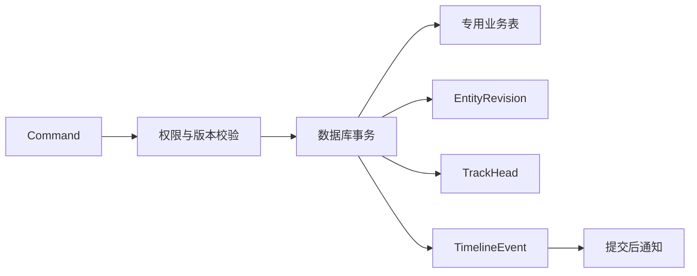
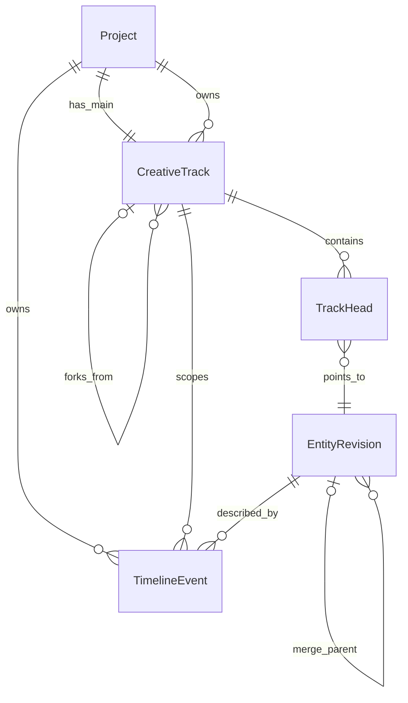

# Entity + State + Timeline + Track

> Zivith 创作状态历史与分支体系
>
> Status: Proposed — design complete 2026-07-28; runtime not implemented
>
> Scope: Architecture, domain model, API contract, and migration plan
>
> Decision: current-state tables + append-only revisions/events; not Event Sourcing
>
> Governance: [ADR-0007](adr/0007-preserve-current-state-with-immutable-creative-history.md) is Proposed; runtime implementation requires acceptance and explicit scheduling

---

## 1. 目的

Zivith 已经拥有稳定的创作实体、审批状态、生成任务和局部重算能力，但状态变化分散在业务表、`AuditLog`、`WorkflowRun.state`、`PromptVersion` 和 `Output` 中。用户可以看到“现在是什么”，却难以统一回答：

- 谁在什么时候把哪个 Entity 从什么状态改成了什么状态？
- 某次 Prompt 或 Video 基于哪个创作快照生成？
- 两个创作方案从哪里分叉，分别改了什么？
- 一个方案合并回主线后，哪些下游结果应标记为 stale？
- 工作流重试是否产生了新的创作决策，还是只重复执行了同一命令？

本体系增加一层通用的创作历史与分支语义，同时保留现有专用领域模型：

1. **Entity** 提供稳定身份。
2. **State** 保存 Entity 的不可变业务 revision。
3. **Timeline** 记录已提交事实并提供统一历史视图。
4. **Track** 承载同一 Project 内可并行比较、合并或废弃的创作方案。

本设计不把 Zivith 改造成事件溯源系统，也不把所有业务对象塞进一张万能 JSON 表。

---

## 2. 术语

### 2.1 Entity

Entity 是具有稳定 ID、明确类型、唯一 Project 作用域和生命周期的领域对象。内容可以变化，身份不变。

首批受支持的 Entity：

| 类别 | Entity 类型 | 当前权威表 |
|---|---|---|
| 叙事 | `story`, `story_segment`, `scene`, `shot` | `stories`, `story_segments`, `scenes`, `shots` |
| 资源 | `asset`, `appearance_variant`, `visual_requirement` | `assets`, `asset_appearance_variants`, `visual_asset_requirements` |
| 产物 | `prompt_version`, `output`, `media` | `prompt_versions`, `outputs`, `media` |

`WorkflowRun`、`WorkflowStep`、`Task` 是执行与编排对象，可以作为 Timeline 事件的 `source`，但不属于 CreativeTrack 的创作 Entity。

Entity 通过逻辑引用表示：

```ts
interface EntityRef {
  project_id: string;
  entity_type: EntityType;
  entity_id: string;
}
```

`EntityRef` 不替代现有外键，也不建立跨类型多态外键。服务层必须验证 Entity 存在且属于同一 Project。

### 2.2 State

State 是某个 Entity 在一个确定 revision 上的不可变业务快照。它描述“Entity 在该版本是什么”，而非“任务执行到了哪里”。

State 必须：

- 具有单调递增的 `revision`；
- 属于一个 `track_id`；
- 指向其父 revision，形成可追溯历史；
- 包含规范化快照或可验证的 snapshot reference；
- 记录 schema 版本与内容 hash；
- 创建后不可更新或删除。

State 不强制所有实体共享一个状态枚举。Zivith 保留不同状态族：

| 状态族 | 示例 | 语义 |
|---|---|---|
| Lifecycle | `AssetState: draft/active/archived` | 是否可被新创作引用 |
| Review | `ApprovalState`, `RequirementStatus` | 创作决策是否通过 |
| Creative progression | `ShotState` | Shot 从编辑到生成、审核、冻结 |
| Generation | `OutputStatus`, `JobStatus` | 技术任务执行结果 |
| Freshness | `fresh/stale` | 上游变化是否使派生产物过期 |

同一 revision 可以同时包含多个状态族，不能把 `active`、`approved`、`completed` 合并成一个通用 `state`。

### 2.3 Timeline

Timeline 是 Project 内已提交事实的有序视图。它由 append-only `TimelineEvent` 构成，用于历史、审计、通知和追踪因果关系。

Timeline 不是：

- 数据库事务日志；
- Workflow step 列表；
- 视频剪辑时间线；
- Entity 当前状态的唯一真源。

每个 Project 拥有独立、单调递增的 `sequence`。`occurred_at` 用于显示时间，`sequence` 用于稳定排序和 cursor 分页。

### 2.4 Track

Track 是同一 Project 内的一条创作方案线。每个 Project 创建时拥有且仅拥有一条不可删除的 `main` Track。

Track 可以从某个 Entity revision 或某个 Project timeline sequence 分叉。分支只保存发生变化的 Entity head；未修改 Entity 按父 Track 的 fork point 读取。

Track 不是：

- Video、Audio、Subtitle 剪辑轨；
- StorySegment；
- 工程计划中的 Track A–G；
- Workflow 的阶段或重试 attempt；
- 跨 Project 的共享分支。

---

## 3. 架构决策

### 3.1 双真相边界

专用业务表仍是**当前状态权威来源**；`EntityRevision` 与 `TimelineEvent` 是**历史权威来源**。

一次成功的命令必须在同一数据库事务内：

1. 校验权限、Track 状态和 `expected_revision`；
2. 更新 main Track 对应的业务表，或保存 branch-only revision；
3. append `EntityRevision`；
4. upsert `TrackHead`；
5. append 一个或多个 `TimelineEvent`；
6. 提交事务后再发布 SSE/队列通知。

如果任一步失败，整个事务回滚。禁止先发事件再更新业务表。



### 3.2 main 与 branch 的写入差异

- `main`：命令同时更新现有业务表和历史表；现有 API 默认操作 `main`。
- 非 `main`：命令只写 revision、head 和 event，不直接修改现有业务表。
- merge 到 `main`：在一个事务内应用已确认的 merged snapshot、更新业务表、创建 main revision、推进 main head、记录 merge 事件并传播 stale。

这样可在不重写所有读取路径的前提下逐步加入分支能力。

### 3.3 快照粒度

revision snapshot 只保存可重建业务语义所需的数据：

- 不保存二进制内容，只引用 `MediaId`；
- 不复制完整父 Entity，只保存当前 Entity 的 canonical state；
- 不复制 Provider 原始响应；保留 provider/model/job ID 和必要 metadata；
- 大于配置阈值的快照可写对象存储，数据库保留 `snapshot_ref`、`snapshot_hash` 和摘要；
- hash 使用 canonical JSON，忽略 `updated_at` 等非业务字段。

Shot 的 `approved_snapshot`、Output 的 `prompt_snapshot/context_snapshot` 继续存在，因为它们是领域冻结语义，不由通用 revision 替代。

---

## 4. 领域模型



### 4.1 CreativeTrack

| 字段 | 类型 | 约束 |
|---|---|---|
| `id` | UUID | PK |
| `project_id` | UUID | 必填，同 Project 内 |
| `key` | string | `(project_id, key)` 唯一；`main` 保留 |
| `name` | string | 用户可见名称 |
| `description` | string? | 分支目的 |
| `status` | enum | `active`, `merged`, `abandoned` |
| `parent_track_id` | UUID? | main 为空；分支必填 |
| `forked_from_sequence` | bigint | 分叉时 Project sequence |
| `created_by` | UUID? | 用户；系统操作可空 |
| `merged_at` / `abandoned_at` | timestamp? | 与 status 一致 |
| `created_at` / `updated_at` | timestamp | 审计字段 |

不变量：

- Track 与 parent 必须属于同一 Project；
- 当前阶段只允许从 `main` 或 active Track 分叉，最大深度建议限制为 8；
- `merged` 与 `abandoned` Track 只读；
- `main` 不可 merge、abandon、delete 或重命名 key；
- Track 不跨 Project；
- 分叉不会复制全部 EntityRevision。

### 4.2 EntityRevision

| 字段 | 类型 | 约束 |
|---|---|---|
| `id` | UUID | PK |
| `project_id` | UUID | 权限与分区键 |
| `track_id` | UUID | 所属 Track |
| `entity_type` / `entity_id` | string / UUID | 逻辑 EntityRef |
| `revision` | int | `(track_id, entity_type, entity_id, revision)` 唯一 |
| `parent_revision_id` | UUID? | 同 Entity 的直接父 revision |
| `merge_parent_revision_id` | UUID? | merge 时的第二父 revision |
| `schema_version` | int | snapshot 结构版本 |
| `snapshot` | JSON? | canonical state |
| `snapshot_ref` | string? | 大快照外部引用 |
| `snapshot_hash` | string | SHA-256 canonical hash |
| `change_kind` | enum | `create`, `update`, `transition`, `delete`, `restore`, `merge`, `baseline` |
| `changed_fields` | string[] | 顶层或 JSON Pointer 路径 |
| `actor_id` | UUID? | 用户；系统可空 |
| `source_type` / `source_id` | string? | workflow/task/api/import |
| `created_at` | timestamp | 不可变 |

`snapshot` 与 `snapshot_ref` 必须恰有一个非空。软删除也创建 revision，snapshot 中保存 `deleted_at`，历史记录本身不软删。

### 4.3 TrackHead

| 字段 | 类型 | 约束 |
|---|---|---|
| `track_id` | UUID | 复合 PK |
| `entity_type` / `entity_id` | string / UUID | 复合 PK |
| `revision_id` | UUID | 指向当前 revision |
| `revision` | int | 冗余以便乐观锁 |
| `updated_at` | timestamp | 排序与诊断 |

TrackHead 是读取优化，不是历史。读取 branch 时：

1. 查询 branch 自身 head；
2. 若不存在，沿 parent Track 查找在 fork point 可见的 head；
3. 得到 snapshot 后再执行现有 inheritance/override resolver；
4. approved Entity 始终优先使用其冻结 snapshot。

为避免每次递归，后续可增加 materialized projection；首版不需要。

### 4.4 TimelineEvent

| 字段 | 类型 | 约束 |
|---|---|---|
| `id` | UUID | PK |
| `project_id` | UUID | 必填 |
| `sequence` | bigint | `(project_id, sequence)` 唯一、单调递增 |
| `track_id` | UUID? | Project 级事件可空 |
| `event_type` | string | 版本化词汇 |
| `schema_version` | int | payload schema 版本 |
| `entity_type` / `entity_id` | string? | 主体 Entity |
| `entity_revision_id` | UUID? | 若事件产生 revision 则关联 |
| `actor_type` / `actor_id` | string / UUID? | `user`, `agent`, `system` |
| `source_type` / `source_id` | string? | `api`, `workflow`, `task`, `import` |
| `correlation_id` | UUID | 一次用户意图/工作流调用 |
| `causation_id` | UUID? | 直接导致本事件的 event |
| `idempotency_key` | string? | 重试去重 |
| `payload` | JSON | 小型事实数据 |
| `occurred_at` | timestamp | 业务发生时间 |
| `created_at` | timestamp | 服务端落库时间 |

`TimelineEvent` 不保存可变的 `before/after` 全量副本。差异由相邻 revision 计算；payload 只保存事实，例如审核意见、失败码、merge 摘要。

---

## 5. State 与命令模型

### 5.1 命令信封

所有接入本体系的写命令使用统一信封：

```ts
interface EntityCommand<TPayload> {
  project_id: string;
  track_id?: string;              // 默认 main
  entity: EntityRef;
  expected_revision: number;      // 新建时为 0
  idempotency_key: string;
  correlation_id?: string;
  payload: TPayload;
}
```

`expected_revision` 与 TrackHead 不一致时返回 `409 REVISION_CONFLICT`，响应包含当前 revision，但不自动覆盖。

相同 `idempotency_key`：

- command type、entity、track、payload hash 全部相同：返回第一次结果；
- key 相同但内容不同：返回 `409 IDEMPOTENCY_KEY_REUSED`；
- 第一次仍在处理：返回 `409 COMMAND_IN_PROGRESS` 或原任务引用。

### 5.2 状态转换

状态转换必须由领域函数验证。现有 `SHOT_TRANSITIONS` 是标准模式：

- command 表达意图，如 `approve_shot`；
- domain transition 校验 from/to 与冻结快照；
- persistence 在事务内写当前状态、revision 和 event；
- 禁止通用 API 直接 patch `state` 字段绕过状态机。

其他状态族逐步增加显式转换表，但不要求先统一所有枚举。

### 5.3 stale 传播

上游 Entity 合并或 main 更新后，依赖图决定下游 freshness：

| 上游变化 | 下游影响 |
|---|---|
| Scene visual context | VisualRequirement → pending；未批准 Shot prompt stale |
| Asset/AppearanceVariant | 未冻结引用 stale；approved Shot/Output 保留快照 |
| Shot creative fields | PromptVersion/Output stale；历史 Output 不删除 |
| Prompt approval | 后续 generation 使用新批准版本；旧 Output 保留 |

每次传播必须记录 `dependency.staled`，payload 包含 `upstream_ref`、`downstream_ref`、`reason` 和 `policy_version`。stale 不等于删除或自动重算。

---

## 6. Track 生命周期

### 6.1 创建与分叉

创建 Track 时记录：

- parent Track；
- fork sequence；
- 可选的 focus Entity；
- 创建目的。

分叉不改变 Entity，也不创建 revision。第一次在分支修改 Entity 时，新 revision 的 `parent_revision_id` 指向 fork point 可见的 revision。

### 6.2 比较

Track compare 返回三方差异：

- `base`：共同祖先 revision；
- `ours`：目标 Track head；
- `theirs`：源 Track head。

差异按 Entity 和字段路径分组。Media、PromptVersion、Output 等不可安全字段级合并的对象使用“选择整个 revision”策略。

### 6.3 合并

首版只支持显式合并，不做无提示自动合并。

合并步骤：

1. 锁定 source/target Track heads；
2. 校验 source 为 `active`，target 为 `main`；
3. 计算三方差异；
4. 无冲突字段可预填建议，但用户必须确认最终 merged snapshot；
5. 对每个 Entity 校验 target `expected_revision`；
6. 在单事务中更新业务表、创建带两个 parent 的 main revision、更新 head；
7. 记录 `track.merged`、`state.changed` 和必要的 `dependency.staled`；
8. source Track 标记 `merged`。

冲突包括：

- base 后 source 与 target 修改同一字段且值不同；
- 一方删除、另一方修改；
- 状态机转换不可组合；
- 引用指向 target 不可见或已归档 Entity；
- approval/freeze snapshot 与合并内容不一致。

### 6.4 废弃

废弃 Track 只改变 Track status 并记录 `track.abandoned`。revision 和 event 永久保留，不影响 main。

---

## 7. Timeline 事件词汇

事件名使用 `<namespace>.<past-tense-fact>`，payload 通过 `schema_version` 演进。已有字段不得改变语义；破坏性变化发布新 event type 或新 schema version。

| Event type | 触发条件 | 关键 payload |
|---|---|---|
| `entity.created` | Entity 首次创建 | `initial_state`, `entity_ref` |
| `state.changed` | 业务字段或状态变化 | `from_revision`, `to_revision`, `changed_fields` |
| `entity.deleted` | 软删除 | `revision`, `reason` |
| `entity.restored` | 恢复软删除 Entity | `revision` |
| `review.decided` | approve/reject/retry | `decision`, `review_kind`, `feedback` |
| `generation.requested` | 生成命令已持久化 | `task_id`, `input_revision_ids` |
| `generation.completed` | 生成结果可用 | `task_id`, `output_id/media_id` |
| `generation.failed` | 最终失败 | `task_id`, `error_code`, `retryable` |
| `dependency.staled` | 上游变化使下游过期 | refs、reason、policy_version |
| `track.created` | Track 分叉 | parent、fork_sequence、focus |
| `track.merged` | Track 合并完成 | source、target、merged revisions |
| `track.abandoned` | Track 废弃 | reason |

技术重试不应重复产生 `generation.requested`；同一 logical command 的 attempt 变化留在 Task/WorkflowStepAttempt。只有最终业务事实进入 Timeline。

---

## 8. API 契约

所有路径位于 `/api/v1`，沿用现有 snake_case 响应。

### 8.1 Timeline 查询

```http
GET /projects/:projectId/timeline
  ?after=<opaque_cursor>
  &limit=50
  &track_id=<uuid>
  &entity_type=shot
  &entity_id=<uuid>
  &event_type=state.changed,review.decided
  &correlation_id=<uuid>
```

响应：

```json
{
  "items": [
    {
      "id": "evt_...",
      "sequence": "1042",
      "event_type": "review.decided",
      "schema_version": 1,
      "track_id": "track_main",
      "entity": { "entity_type": "shot", "entity_id": "shot_1" },
      "revision": 8,
      "actor": { "actor_type": "user", "actor_id": "user_1" },
      "payload": { "decision": "approve", "review_kind": "shot" },
      "occurred_at": "2026-07-28T08:00:00.000Z"
    }
  ],
  "next_cursor": "opaque",
  "has_more": true
}
```

Cursor 编码 `(project_id, sequence)`，对客户端不透明。默认 `limit=50`，最大 200。权限必须先校验 Project membership，再应用过滤条件。

辅助查询：

```http
GET /projects/:projectId/entities/:entityType/:entityId/revisions
GET /projects/:projectId/entities/:entityType/:entityId/revisions/:revision
GET /projects/:projectId/correlations/:correlationId/timeline
```

### 8.2 Track

```http
GET    /projects/:projectId/tracks
POST   /projects/:projectId/tracks
GET    /projects/:projectId/tracks/:trackId
POST   /projects/:projectId/tracks/:trackId/compare
POST   /projects/:projectId/tracks/:trackId/merge
POST   /projects/:projectId/tracks/:trackId/abandon
```

创建：

```json
{
  "key": "character-young-look",
  "name": "角色年轻形象方案",
  "description": "尝试更年轻的妆造",
  "parent_track_id": "track_main",
  "forked_from_sequence": "1030",
  "focus": { "entity_type": "appearance_variant", "entity_id": "variant_1" }
}
```

合并：

```json
{
  "target_track_id": "track_main",
  "expected_target_heads": [
    { "entity_type": "appearance_variant", "entity_id": "variant_1", "revision": 4 }
  ],
  "resolutions": [
    {
      "entity_type": "appearance_variant",
      "entity_id": "variant_1",
      "strategy": "use_source"
    }
  ],
  "idempotency_key": "merge_..."
}
```

### 8.3 Entity 写入兼容

现有资源路由继续可用，默认 main Track。接入后要求：

- 请求支持 `If-Match: "<revision>"`，迁移期也可接受 body `expected_revision`；
- 响应增加 `entity_revision` 与 `track_id`；
- 非 main 写入使用显式 `X-Zivith-Track-Id` 或新 command endpoint；
- 缺失 revision 的旧客户端仅在兼容窗口内允许 last-write-wins，并记录 metric；
- 兼容窗口结束后，接入 Entity 的写操作缺少 revision 返回 `428 PRECONDITION_REQUIRED`。

### 8.4 错误

| HTTP | code | 含义 |
|---|---|---|
| 400 | `INVALID_TRACK_OPERATION` | 不满足 Track 生命周期 |
| 403 | `PROJECT_ACCESS_DENIED` | 无 Project 权限 |
| 404 | `ENTITY_OR_TRACK_NOT_FOUND` | 不存在或跨 Project |
| 409 | `REVISION_CONFLICT` | expected revision 过期 |
| 409 | `MERGE_CONFLICT` | 需要用户解决冲突 |
| 409 | `IDEMPOTENCY_KEY_REUSED` | key 与原命令不一致 |
| 422 | `INVALID_STATE_TRANSITION` | 违反领域状态机 |
| 428 | `PRECONDITION_REQUIRED` | 缺少 expected revision |

---

## 9. Prisma 数据结构提案

这是迁移目标，不在本设计阶段直接修改 schema。

```prisma
enum CreativeTrackStatus {
  active
  merged
  abandoned
}

enum EntityChangeKind {
  baseline
  create
  update
  transition
  delete
  restore
  merge
}

model CreativeTrack {
  id                 String              @id @default(uuid())
  projectId          String              @map("project_id")
  key                String
  name               String
  description        String?
  status             CreativeTrackStatus @default(active)
  parentTrackId      String?             @map("parent_track_id")
  forkedFromSequence BigInt              @map("forked_from_sequence")
  createdBy          String?             @map("created_by")
  mergedAt           DateTime?           @map("merged_at")
  abandonedAt        DateTime?           @map("abandoned_at")
  createdAt          DateTime            @default(now()) @map("created_at")
  updatedAt          DateTime            @updatedAt @map("updated_at")

  @@unique([projectId, key])
  @@index([projectId, status, createdAt])
  @@map("creative_tracks")
}

model EntityRevision {
  id                    String           @id @default(uuid())
  projectId             String           @map("project_id")
  trackId               String           @map("track_id")
  entityType            String           @map("entity_type")
  entityId              String           @map("entity_id")
  revision              Int
  parentRevisionId      String?          @map("parent_revision_id")
  mergeParentRevisionId String?          @map("merge_parent_revision_id")
  schemaVersion         Int              @default(1) @map("schema_version")
  snapshot              Json?
  snapshotRef           String?          @map("snapshot_ref")
  snapshotHash          String           @map("snapshot_hash")
  changeKind            EntityChangeKind @map("change_kind")
  changedFields         String[]         @default([]) @map("changed_fields")
  actorId               String?          @map("actor_id")
  sourceType            String?          @map("source_type")
  sourceId              String?          @map("source_id")
  createdAt             DateTime         @default(now()) @map("created_at")

  @@unique([trackId, entityType, entityId, revision])
  @@index([projectId, entityType, entityId, createdAt])
  @@index([parentRevisionId])
  @@map("entity_revisions")
}

model TrackHead {
  trackId      String   @map("track_id")
  entityType  String   @map("entity_type")
  entityId    String   @map("entity_id")
  revisionId  String   @map("revision_id")
  revision    Int
  updatedAt   DateTime @updatedAt @map("updated_at")

  @@id([trackId, entityType, entityId])
  @@unique([trackId, revisionId])
  @@index([entityType, entityId])
  @@map("track_heads")
}

model TimelineEvent {
  id               String   @id @default(uuid())
  projectId        String   @map("project_id")
  sequence         BigInt
  trackId          String?  @map("track_id")
  eventType        String   @map("event_type")
  schemaVersion    Int      @default(1) @map("schema_version")
  entityType       String?  @map("entity_type")
  entityId         String?  @map("entity_id")
  entityRevisionId String?  @map("entity_revision_id")
  actorType        String   @map("actor_type")
  actorId          String?  @map("actor_id")
  sourceType       String?  @map("source_type")
  sourceId         String?  @map("source_id")
  correlationId    String   @map("correlation_id")
  causationId      String?  @map("causation_id")
  idempotencyKey   String?  @map("idempotency_key")
  payload          Json     @default("{}")
  occurredAt       DateTime @map("occurred_at")
  createdAt        DateTime @default(now()) @map("created_at")

  @@unique([projectId, sequence])
  @@unique([projectId, idempotencyKey])
  @@index([projectId, trackId, sequence])
  @@index([projectId, entityType, entityId, sequence])
  @@index([projectId, eventType, sequence])
  @@index([projectId, correlationId, sequence])
  @@map("timeline_events")
}
```

实现迁移时还需增加外键、Project sequence allocator，以及 `snapshot XOR snapshot_ref`、Track status 时间字段一致性等数据库 CHECK 约束。Prisma 无法完整表达的约束写入 SQL migration。

Project sequence 建议使用独立 `project_sequences(project_id PK, last_value bigint)`，在事务中执行原子 `UPDATE ... SET last_value = last_value + 1 RETURNING last_value`。不能使用时间戳或全局 sequence 替代 Project 内顺序。

---

## 10. 迁移计划

### Phase 0：准备与观测

- 冻结事件词汇 v1 和每类 Entity 的 canonical snapshot serializer。
- 为现有写路径建立清单，识别直写 Prisma、事务边界与 AuditLog 调用。
- 增加 shadow-write feature flag、差异 metric 和 dead-letter 诊断记录。
- 不改变客户端 API。

回滚：关闭 feature flag，无新表依赖。

### Phase 1：建表与基线

- 创建 `creative_tracks`、`entity_revisions`、`track_heads`、`timeline_events`、`project_sequences`。
- 为每个 Project 创建 `main` Track。
- 按批次回填首批 Entity 的 `baseline` revision 和 head。
- baseline snapshot 直接读取当前业务表；`created_at` 保留原时间，timeline `occurred_at` 标记为迁移时间并设置 `source_type=migration`。
- 关键 `AuditLog` 可转换为 TimelineEvent，但不伪造缺失 revision；无法证明顺序的历史只作为 `legacy.audit_imported`。

回滚：业务读取仍不依赖新表；停止回填并保留表供诊断。

### Phase 2：main 双写

按风险从低到高接入：

1. Shot、PromptVersion、Output；
2. AppearanceVariant、VisualRequirement；
3. Story、StorySegment、Scene、Asset；
4. Media 只记录生命周期与生成事实，不复制大 metadata。

每个写路径在原事务中调用统一 `recordEntityChange`。shadow 模式先计算但不阻断；一致率达到阈值后启用强一致双写。

验证：

- business row hash 与 main head snapshot hash 一致；
- revision 连续且无重复；
- command 重试不产生重复 event；
- approved snapshot 与 revision 可追溯。

回滚：关闭该 Entity 类型双写；业务表保持权威。已写历史不删除。

### Phase 3：Timeline 读取与并发控制

- 上线只读 Timeline/revision API。
- UI 先以只读历史面板消费。
- 写 API 返回 revision，先告警缺失 `If-Match`，再逐 Entity 启用 428。
- SSE 从提交后的 TimelineEvent 读取，不再用整行指纹表达业务变化；Workflow 专用进度 SSE 可继续存在。

回滚：Timeline UI 降级隐藏；现有资源读取不变。

### Phase 4：CreativeTrack

- 先开放 AppearanceVariant 和 Shot 两种可分支 Entity。
- branch 写入仅进入 revision/head，不改业务表。
- compare 初期只读；merge 需人工确认并仅允许 target=main。
- 验证 stale 传播后再扩展到 Scene/Asset。

回滚：禁止新建/合并 Track；已有 Track 只读。main 业务状态不受影响。

### AuditLog 处置

- 迁移期保留 `AuditLog`，避免影响现有合规查询。
- 新接入路径以 TimelineEvent 为主，并可临时双写 AuditLog。
- 当查询、保留期和权限等价后停止新增 AuditLog。
- 不删除旧 AuditLog；文档标记其覆盖不完整。

---

## 11. 端到端验证

### 11.1 Shot 修改到批准

初始：main 上 Shot revision 7，状态 `draft`。

1. 用户修改 camera，提交 `expected_revision=7`。
2. 事务更新 `shots`，创建 revision 8，记录 `state.changed`。
3. scoped recompute 将旧 Prompt 标记 stale，记录 `dependency.staled`。
4. Prompt 构造命令记录 `generation.requested`，完成后创建 PromptVersion 和各自 revision/event。
5. 视频任务以 Shot revision 8、批准 PromptVersion revision 和 VisualRequirement revisions 作为 `input_revision_ids`。
6. 任务重试只增加 Task attempt；不重复 `generation.requested`。
7. 完成后创建 Output，记录 `generation.completed`；Shot 进入 review。
8. 用户批准 Shot，领域函数要求 approved snapshot；创建 revision 9 与 `review.decided`。
9. 后续 Asset 修改不会改变该 approved snapshot 或历史 Output，只会影响未冻结引用。

可回答：Output 使用了哪一版 Shot/Prompt/视觉资产、谁批准、经历了哪些 stale 与重算。

### 11.2 角色形象分支并合并

初始：AppearanceVariant main revision 4。

1. 用户从 sequence 1030 创建 `character-young-look` Track。
2. 分支首次修改 description，创建 branch revision 1，其 parent 指向 main revision 4。
3. 分支生成多个候选 Media；事件引用 Media ID，不复制文件。
4. 用户批准候选，分支 head 推进；main 业务表不变。
5. compare 以 main revision 4 为 base，展示 description、anchor_media_id 和 review state 差异。
6. 若 main 仍为 revision 4，用户确认 `use_source` 后合并。
7. 同一事务更新 `asset_appearance_variants`、创建 main revision 5、推进 main head、记录 `track.merged`。
8. 引用该 variant 且未冻结的 VisualRequirement/Shot 被标记 stale；approved Shot 保留原快照。
9. Track 状态变为 `merged` 并只读。

若 main 已变为 revision 5，原合并请求返回 `REVISION_CONFLICT`，必须重新 compare，不自动覆盖。

---

## 12. 权限、保留与安全

- 所有查询先按 `project_id` 校验 owner/editor/viewer；不能仅凭 event/entity ID 查询。
- viewer 可读 Timeline；editor 可建 Track 和提交 revision；Track merge/abandon 默认要求 editor，Project 可配置仅 owner。
- payload 不保存 provider secret、认证 token、原始上传内容或未脱敏用户输入。
- actor/source 不可由普通客户端任意伪造，由认证与执行上下文注入。
- TimelineEvent、EntityRevision 默认随 Project 生命周期保留；Project 软删除后不可见但不立即物理删除。
- 用户数据删除按合规策略执行整 Project 分区清理；单 Entity 软删除不清理历史。
- 外部 snapshot_ref 使用与 Project 相同的存储 ACL 和生命周期策略。
- timeline 导出必须包含 schema version、hash 和 sequence，便于校验完整性。

---

## 13. 性能与运维

- Timeline 使用 cursor 分页，禁止 offset 深分页。
- 按 `project_id` 开头建立所有主要索引，未来可按 Project hash 分区。
- `payload` 与 snapshot 设置大小上限；大数据转外部存储。
- 监控：双写失败率、business/head hash 不一致、revision conflict、幂等命中、merge conflict、sequence 分配延迟。
- 定期一致性任务只报告并隔离异常，不自动重写历史。
- append-only 由数据库权限和 trigger/规则共同保护：应用角色无 UPDATE/DELETE revision/event 权限。

---

## 14. 与现有系统的边界

### Workflow

Workflow 是命令发起者和执行编排器。它通过 `source_type=workflow`、`source_id=run_id/step_id` 关联事件，但 `WorkflowRun.state` 不进入 CreativeTrack，也不作为 EntityRevision。

### Generation Queue

Task/Output 保留技术状态。Timeline 只记录 requested、completed、failed 等业务事实；attempt、心跳、进度百分比不进入 Timeline。

### Resolution 与 Freeze

现有 Project → Story → Scene → Shot 的读时 inheritance 继续工作。Track 先选择每个 Entity 的可见 revision，再执行 resolver。approved Scene/Shot 继续读取冻结 snapshot，避免历史上游变化静默污染。

### Cut 与剪辑轨

未来 Cut 的 Video/Audio/Subtitle Track 是独立领域。剪辑 Track 可作为 Entity 被本体系版本化，但不能复用 `CreativeTrack` 表达时间位置或媒体叠放。

---

## 15. 明确不做

- 不建立万能 `entities` 表替代 Story/Scene/Shot/Asset 等专用表。
- 不采用完整 Event Sourcing，不从 TimelineEvent 重放整个业务数据库。
- 不允许跨 Project Track 或引用。
- 不自动解决有语义冲突的合并。
- 不把 Workflow step、Task attempt 或工程 Track 当成 CreativeTrack。
- 不把 Video/Audio/Subtitle 剪辑轨混入本模型。
- 不修改或压缩已提交的 revision/event。
- 不因 stale 自动删除 Output 或自动触发昂贵重算。

---

## 16. 验收条件

进入实现 RFC 前必须满足：

- 每个首批 Entity 有 canonical snapshot schema 与 schema migration 策略；
- main 写入可在单事务内更新业务表、revision、head 和 event；
- 并发写通过 expected revision 稳定返回 409；
- 相同幂等命令不会产生重复 revision/event；
- Project Timeline 的 sequence 在并发事务下严格唯一且单调；
- branch 不修改 main 业务表；
- merge 冲突不会部分提交；
- Shot 生成链能追踪全部 input revisions；
- AppearanceVariant 分支可 compare、merge 并传播 stale；
- approved snapshot 与历史 Output 不被后续上游变化改写；
- Timeline 权限、软删除、保留、导出和回滚策略经过安全评审。
