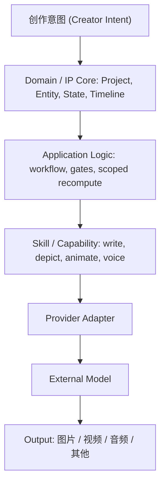
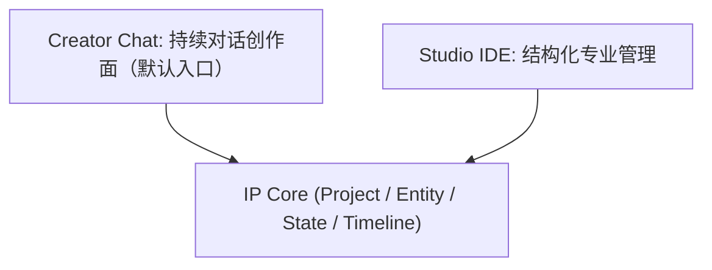

# Product Positioning

> Zivith 产品核心定位与阶段规划
>
> Version: 1.0
>
> Status: Accepted — 由 [ADR-0008](../architecture/adr/0008-zivith-is-an-ai-understandable-ip-creation-system.md) 确立，设计源自 [IP World Model Repositioning RFC](../architecture/rfc/IP-World-Model-Repositioning-RFC.md)
>
> Last Updated: 2026-07-31
>
> Related: [architecture-principles.md](../architecture/architecture-principles.md), [Design-Philosophy.md](Design-Philosophy.md), [Core-Domain-Model.md](../domain/Core-Domain-Model.md), [Entity + State + Timeline + Track](../architecture/entity-state-timeline-track.md)

---

## 北极星

> **Zivith is not an AI generation tool. Zivith is an AI-understandable IP creation system.**
>
> **Zivith 不是一个 AI 内容生成工具，而是一个让 AI 理解、管理并持续参与 IP 创作的系统。**

这句话是全项目的判断基准。当一个功能提案的价值无法归入「增强 IP 理解 / 世界管理 / 创作者控制」中的任意一项时，它大概率不属于 Zivith 的核心，应当被拒绝或下放到 Extension / Provider 层。

---

## 1. 产品重新定位

Zivith 不再定位为单纯的 AI 视频生成工具。

职责边界非常清晰：

| 角色 | 负责 |
|------|------|
| AI 模型 | 执行生成 |
| Zivith | 管理创作意图、世界设定、角色关系、时间发展、制作上下文 |

这一定位并不推翻 Zivith 既有的电影制作能力，而是把它放回正确的位置：`Story` / `Scene` / `Shot` / `Output` 是**表达与产出层**，它们服务于其上的 IP 世界，而不是反过来。

---

## 2. 核心理念：AI 能力增强不会替代创作管理

未来的模型会在视频、图像、文本、多模态理解上持续变强。但一个完整 IP 的产生从来不是一句话生成的结果，因为：

- 用户需求需要不断探索
- 创作方向需要不断调整
- 世界规则需要长期维护
- 角色关系需要持续演化

因此结论是反直觉但稳固的：

> AI 生成能力越强，越需要一个管理创作上下文的系统。

这与宪法的三条不变量一致（[architecture-principles.md §1](../architecture/architecture-principles.md)）：创作 IP 会复利累积、调用方会持续多样化、生成管线的形状必然变形。唯一不随模型进步而贬值的资产，是被结构化保存下来的创作意图与世界状态。

---

## 3. 术语映射（强制约定）

新定位引入的产品概念必须落到既有领域契约上，**不得另起炉灶**。产品文档与代码使用同一套英文领域词，避免概念长期漂移。

| 产品叙述中的说法 | Zivith 实际契约 | 说明 |
|------------------|-----------------|------|
| IP | **`Project`** | 不新增顶层实体。`Project` 的定义本就是「a complete creative universe / an entire IP」 |
| Character（角色） | **`Asset(type=character)`** + `EntityRevision` 历史 | 角色的阶段性变化由 State 历史表达，不是复制多个角色 |
| Scene（地点 / 环境 / 历史） | **`Location`**（`Asset(type=location)`） | ⚠️ Zivith 的 `Scene` 是**叙事单元**（一段连续时空、拥有 `Shot`）。世界中的「地点」是 `Location`，两者不得混用 |
| Event（世界事件） | **`WorldEvent`**（规划中） | 与既有 `ChangeEvent`（系统审计事实）严格区分。`ChangeEvent` 记录「系统里发生了什么」，`WorldEvent` 记录「故事世界里发生了什么」 |
| Relationship（关系） | 首版为 `Entity` State 的结构化字段 | 仅在出现真实的跨实体查询需求后，才提升为独立 Entity |
| Timeline（世界线） | **`Timeline`**（Presentation-led，[ADR-0007](../architecture/adr/0007-preserve-current-state-with-immutable-creative-history.md)） | 不新增概念。Presentation Time 是稳定主轴，World Time 是可选绑定层 |
| Skill（转换层） | **能力层，不是领域实体** | 见 §6 与 [ADR-0009](../architecture/adr/0009-skill-is-a-capability-layer-not-a-domain-entity.md) |

领域词在中文正文中一律保留英文原词（`Project`、`Entity`、`EntityRevision`、`Asset`、`Timeline`、`Relationship`、`WorldEvent`、`Shot`、`PromptVersion`、`Output`），以保证产品文档与代码之间不产生同义异名。

---

## 4. 系统分层



两个入口都落在同一个 IP Core 之上：



分层的意义在于：未来模型更替时，被替换的是 Skill 与 Provider Adapter，`IP Core`、`Timeline`、Entity Model 保持不变。

---

## 5. IP Core（世界理解层）

目标：**让 AI 理解一个持续发展的创作世界。**

### Project（即 IP）

一个完整创作项目，承载世界观、故事方向、基础设定，以及其下全部 `Asset`、`Story` 与创作历史。

### Character

由 `Asset(type=character)` 表达，管理基础信息、外貌、性格、背景、能力、关系与随时间变化的状态。

角色的阶段性演化通过 `EntityRevision` 的 State 历史表达，而不是创建多个独立角色：

```
Character: 林夜
  State @ 阶段一  普通学生
  State @ 阶段二  觉醒能力
  State @ 阶段三  成为领袖
```

### Location

由 `Asset(type=location)` 表达，管理地点、环境、历史、相关事件与关联角色。

### WorldEvent

管理世界内发生、且可影响多个 Entity 的事件：发生时间、影响对象、前置条件、后续变化。规划中的新实体，尚未落库。

### Relationship

管理人物关系、阵营关系、世界关联，例如「角色A —师徒— 角色B」。首版作为 Entity State 的结构化字段存在。

### Timeline

管理时间发展、事件顺序与角色状态变化。它回答的核心问题是：**这个世界现在处于什么阶段。**

Presentation Time 是稳定主轴；World Time 只在创作者表达倒叙、模糊时段、时间区间、时间跳跃或平行世界时才偏离主轴。Zivith 不把虚构世界强行压进单一日历。

### 谁来维护这一层

IP Core 由两个 Agent 角色负责：**World Builder** 创建与补全世界，**Lore Keeper** 检查一致性并沉淀知识；下游的 **Production Planner** 把世界转为 Story / Scene / Shot，**Generation** 负责调模型。角色是领域词汇，执行阶段标识（`AgentId`）与全部评审门保持不变。完整划分见 [AI-Agent-Collaboration.md](../domain/AI-Agent-Collaboration.md) Part I。

---

## 6. Skill 是能力层，不是领域实体

Skill 是既有 capability boundary（宪法 P4）的产品化命名。它把「IP 状态 → 事件 → 角色状态 → 生成请求」这条转换链路命名出来，便于讨论，但**不进入领域模型**。

以视频生成为例，`Shot Generation Skill` 指的就是现有的这条链路：

```
Shot Specification  →  Prompt Builder  →  PromptVersion  →  Video Provider  →  Output
```

Skill 没有 identity、没有 revision、没有 ownership，不落库、不出现在导出数据里。未来增强 AI 能力的正确做法是**增强 Skill、替换 Provider**，而不是新增十几个模型相关的领域对象。

这直接服从宪法 §3 的「模型靠加深而非加宽生长」。若 Skill 被建成实体，领域模型会滑向 `IP / Character / Scene / Shot / Skill / Asset / Workflow` 的大杂烩，十年后无法维护。

---

## 7. Creator Chat（世界优先的持续对话创作面）

**目标：降低首次使用门槛，并成为长期创作入口。** 新用户不应该在第一次打开 Zivith 时就面对数据结构、时间线与专业工作流。打开应用即进入对话（`/`），无登录门禁（本地单用户模式，[ADR-0013](../architecture/adr/0013-local-single-user-mode-no-login.md)）。

用户只需要用自然语言描述想法：

> 我想创造一个东方玄幻世界。

对话智能体据此引导用户补全世界背景、力量体系、主角设定与核心冲突，并**自动创建任务（IP / 项目）**：经提案与用户确认后，后台产出结构化的 `Project`、`Asset(type=character)`、`Asset(type=location)`、`WorldEvent` 与 `Relationship` 草案，一律以 `draft` 进入，可编辑、可拒绝。随着内容累积，用户可像 Trae / Cursor 切换 IDE 一样进入 Studio 世界工作区（`/projects/[id]/world`），对话与工作区双向可达。

**Creator Chat 是持续对话创作面，不是一次性向导。** 边界由 [ADR-0010](../architecture/adr/0010-creator-chat-is-the-world-first-continuous-conversation-surface.md)（2026-08-04 修订）锁定：

- 写库必须提案且经用户确认，AI 永不自主写库；产物默认 `draft`，gate 不可绕过
- 设定冲突只报告不修复（H9 v1）；选择哪一则存活是作者权
- 对话记录是会话工作底稿，**不是**创作产物，不作为创作载体展示或导出
- 它**不是** Director Copilot，**不是**通用问答助手
- 对话围绕「世界」持续进行：用户后续创作中可随时回到对话补充事件、调整关系、修订设定

这对应宪法 §9.2（2026-08-04 修订）「把聊天记录当作创作宇宙本身」的反向表述：对话可以做创作入口，但创作面始终是结构化的世界模型。

---

## 8. Studio IDE（专业管理模式）

Studio 不作为新用户的默认入口，但它是系统的完整能力面：修改 Entity、管理 Relationship、调整 Timeline、查看 Asset、规划制作。

定位类比游戏引擎编辑器与专业设计软件——复杂 IP 管理确实需要专业工具，只是不应该成为第一次使用时的门槛。这对应宪法既有的 *Simple by Default / Powerful When Needed*。

---

## 9. 多媒体生产（输出能力，非核心）

图片生成、视频生成、配音、音乐、剪辑装配都是输出能力，不是产品核心。

原则：

> Zivith 管理创作逻辑，不绑定某一个模型。

模型格局变化时，只需替换 Video Skill / Image Skill / Audio Skill 背后的 Provider，`IP Core`、`Timeline`、Entity Model 均不改变。

---

## 10. Zivith 不做什么

明确「不做什么」和明确「做什么」同等重要，否则每次看到新的 AI 能力都会不断扩张范围。

| 不做 | 归属 | 依据 |
|------|------|------|
| 自研基础模型 | Provider | 宪法 §9「A model foundry」 |
| 自研视频 / 图像 / 音频生成模型 | Provider | 同上；P4 要求模型是可替换外设 |
| 专业非线性剪辑（NLE）替代品 | Extension / 外部工具 | 宪法 D4；Zivith 只保留领域内的 Cut 装配 |
| 3D 引擎开发 | Extension | 3D 是长期方向的**表现形式**，核心仍是世界管理 |

长期方向（3D / 游戏 / 虚拟世界）的形态是 `IP Core → 3D Asset → Game World → Virtual Experience`，但它不是当前目标，且其中 Zivith 负责的部分依然只有 IP Core。

---

## 11. MVP 原则

第一阶段不追求视频生成、复杂剪辑、3D 世界或全自动制作。优先验证四件事：

1. 用户是否愿意创建 IP
2. AI 是否能够帮助用户整理世界
3. 用户是否需要管理角色和关系
4. 世界结构是否能持续扩展

落地排期见 [IP World Model Repositioning RFC](../architecture/rfc/IP-World-Model-Repositioning-RFC.md) 的 capability ramp，以及 [Next Tasks](../planning/Next-Tasks.md) 的 Track I / Track J。

---

## 总结

Zivith 的核心不是让 AI 生成内容，而是让 AI 理解一个世界，并帮助人类持续创造这个世界。

模型负责生成；Zivith 负责理解、组织、管理、转换——成为 AI 创作时代里人与模型之间的桥梁。
