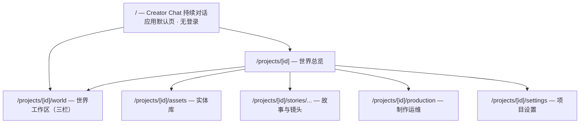
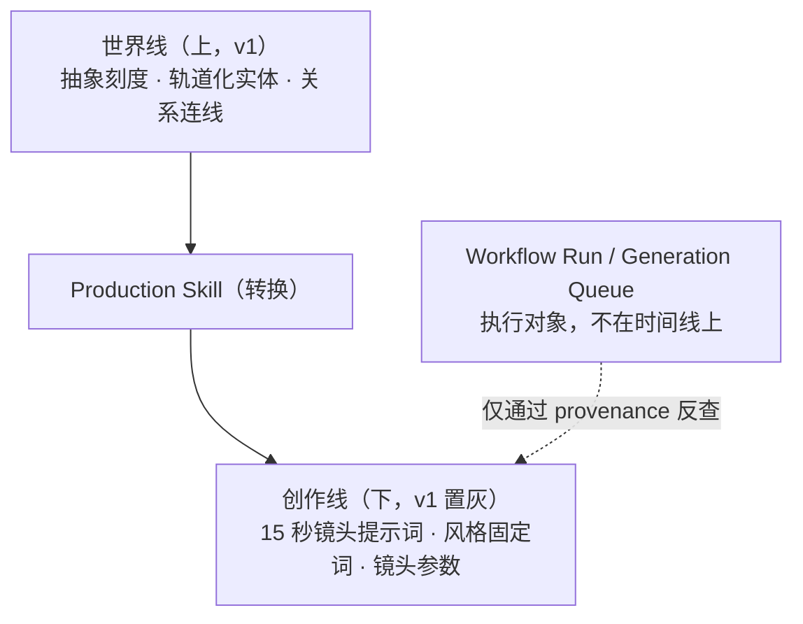

# UI Information Architecture

> Zivith 界面信息架构 — 从生成优先转向世界优先（创造层优先）
>
> Version: 1.1
>
> Status: Draft — 落地任务见 [Next Tasks](../planning/Next-Tasks.md) Track K（Track K 已随 `feat/creator-layer-first` 分支开工，2026-08-04）
>
> Last Updated: 2026-08-04
>
> Related: [Product-Positioning.md](Product-Positioning.md), [Design-Philosophy.md](Design-Philosophy.md), [Core-Domain-Model.md](../domain/Core-Domain-Model.md), [AI Creative IDE RFC](../architecture/rfc/AI-Creative-IDE-RFC.md), [ADR-0007](../architecture/adr/0007-preserve-current-state-with-immutable-creative-history.md), [ADR-0010](../architecture/adr/0010-creator-chat-is-the-world-first-continuous-conversation-surface.md), [ADR-0013](../architecture/adr/0013-local-single-user-mode-no-login.md)

---

## 1. 目的与判据

[ADR-0008](../architecture/adr/0008-zivith-is-an-ai-understandable-ip-creation-system.md) 把 Zivith 定位为 AI 可理解的 IP 创作系统，但界面还停留在上一个定位。本文档定义界面应该长成什么样，以及怎么迁移过去。

单一判据：

> 打开一个 `Project`，最先看到的应该是**这个世界**，而不是生成这个世界所用的机器。

本文档只管信息架构——有哪些界面区域、它们承载什么、彼此如何导航。视觉设计、组件样式、交互细节不在范围内。

---

## 2. 现状盘点（2026-07-31）

以下是代码事实，不是评价。

### 2.1 现有路由

```
/                                        → redirect('/projects')，无落地页
/login  ·  /register                     → 认证
/projects                                → 项目卡片列表（CRUD）
/projects/[projectId]                    → 项目主页
/projects/[projectId]/assets             → 资产库（角色 / 地点按钮切换，非 URL tab）
/projects/[projectId]/assets/[assetId]   → 资产详情（参考图、设定表、形象变体）
/projects/[projectId]/stories/[storyId]  → 故事编辑器（Scene CRUD 内嵌于此）
      …/scenes/[sceneId]/shots/[shotId]  → 镜头编辑器
```

`Scene` 没有独立页面，内嵌在 Story 编辑器中。侧栏导航只有三项：项目、故事、角色与场景。

### 2.2 项目主页的当前构成

从上到下依次是：

1. `ProviderPanel` — 模型提供商与模型选择
2. `UsageSummaryCard` — API 用量统计
3. `WorkflowPanel` — Story-to-Video 工作流与各阶段评审（约 1700 行，系统中最大的组件）
4. `GenerationQueuePanel` — 视频生成任务队列
5. 故事卡片列表

### 2.3 诊断

**信息架构是生成优先的。** 打开一个项目，前两屏是模型选择器和用量统计——它们是运维工具，不是创作内容，却占据了最显眼的位置。

**世界完全不可见。** 没有任何界面回答「这个世界现在处于什么阶段」。资产页只有角色和地点两个平铺列表，没有关系、没有事件、没有时间线、没有角色的状态演化。`Character` 的 `EntityRevision` 历史在 Track H 已经开始写入，但界面上无处呈现。

**导航层级与领域层级不一致。** 侧栏把「角色与场景」并列为一个入口，而领域模型里 `Character`（世界实体）与 `Scene`（叙事单元）分属两层；这个命名本身就在强化上一节术语映射要消除的混淆。

---

## 3. 目标信息架构

### 3.1 两层对应两组界面



界面分组直接映射领域的两层：**世界层**由世界总览、世界工作区、实体库承载；**表达层**由故事与镜头承载；**运维**从内容区剥离，单独成区。

### 3.2 路由映射

| 目标路由 | 状态 | 承载 |
|----------|------|------|
| `/` | **新增** | Creator Chat 持续对话，应用默认入口；无登录，本地单用户模式（ADR-0013）；对话自动创建任务（IP / 项目） |
| `/projects/new` | 降级 | 手动创建项目的回退入口（默认创建路径改为 Creator Chat 自动创建） |
| `/projects/[id]` | **重构** | 世界总览（取代现有的面板堆叠） |
| `/projects/[id]/world` | 新增 | 世界工作区（2026-08-04 三栏）：左实体 Explorer / 中 Timeline + 副驾驶 agent 面板 / 右 Inspector（右上世界线属性、右下创作线属性，v1 创作线置灰标「后续」） |
| `/projects/[id]/assets` | 保留 | 实体库，导航名改为「实体库」 |
| `/projects/[id]/assets/[assetId]` | 保留 | 实体详情，增补 State 历史与关系 |
| `/projects/[id]/stories/...` | 保留不动 | 表达层，现有路由全部有效 |
| `/projects/[id]/production` | 新增 | `WorkflowPanel` + `GenerationQueuePanel` 迁入 |
| `/projects/[id]/settings` | 新增 | `ProviderPanel` + `UsageSummaryCard` 迁入 |

现有路由**一个都不删除**。这是 [AI Creative IDE RFC](../architecture/rfc/AI-Creative-IDE-RFC.md) 第 9 节迁移规则的要求：在替代界面达到功能对等之前，既有编辑器保持可用。

### 3.3 侧栏导航

| 现在 | 目标 |
|------|------|
| 项目 | 创作对话（`/`，默认入口） |
| 故事 | 世界总览 |
| 角色与场景 | 世界工作区 |
| — | 实体库 |
| — | 故事 |
| — | 制作 |
| — | 设置 |

「角色与场景」这个名字要改掉。`Scene` 是叙事单元，属于故事；实体库里放的是 `Character` 与 `Location`。

---

## 4. 世界总览（项目主页）

回答一个问题：**这个世界现在处于什么阶段。**

建议包含五块，按重要性排序：

1. **世界状态摘要** — 世界观要点、当前所处阶段、`Timeline` 的最新位置
2. **角色现状** — 主要 `Character` 及其当前 State，而不只是一张参考图
3. **最近事件** — 最近的 `WorldEvent` 及其影响到的实体（依赖 Track I）
4. **待处理评审** — 卡在 gate 上的项，直接跳转到对应界面
5. **最近产出** — 最近的 `Output`，作为世界的产出而非页面主体

`ProviderPanel`、`UsageSummaryCard`、`GenerationQueuePanel` 全部撤出此页。它们不消失，只是搬到 `/production` 与 `/settings`——运维工具不该占据内容区的第一屏。

---

## 5. 世界工作区

### 5.1 三栏布局（2026-08-04 用户设计）

[AI Creative IDE RFC](../architecture/rfc/AI-Creative-IDE-RFC.md) 第 5 节定义了四窗格。Director Console 属于该 RFC 的 Slice C，受 [Director Copilot RFC](../architecture/rfc/Director-Copilot-RFC.md) 管辖、排期 Phase 3+。2026-08-04 创造层优先设计将世界工作区定为**左中右三栏**：

```text
┌──────────────┬───────────────────────────────┬────────────────┐
│ Entity       │ Timeline（世界线主体）         │ Inspector      │
│ Explorer     ├───────────────────────────────┤ 右上：世界线    │
│ 世界观 / 角色 │ 副驾驶 agent 面板              │       实体属性  │
│ 场景 / 事件   │ （协助管理 IP / 项目）         │ 右下：创作线    │
│              │                               │       实体属性  │
│              │                               │ （v1 置灰「后续」）│
└──────────────┴───────────────────────────────┴────────────────┘
```

- **左栏 — Entity Explorer**：展示 IP / Project 的实体集合（世界观 / 角色 / 场景 / 事件），驱动选择。
- **中栏 — Timeline 主体 + 副驾驶 agent 面板**：大部分为世界线时间轴，一部分为副驾驶 agent 面板，协助管理 IP / 项目。
- **右栏 — Inspector**：展示选中实体的详细属性，**上下分栏**——右上为世界线的实体属性，右下为创作线的实体属性（v1 创作线置灰标「后续」）。

### 5.2 世界线与创作线：上下双时间线

2026-08-04 创造层优先设计将「一条 Timeline 的两个视图」改为**上下两条时间线**。上层是**世界线**（v1 实现），下层是**创作线**（v1 置灰，标「后续」）：

- **世界线（上）** — 时间**抽象化，不做均匀刻度**：刻度是纯展示坐标，不做真实时间换算，因此不要求世界编年可全局排序，也就不触碰 [ADR-0007](../architecture/adr/0007-preserve-current-state-with-immutable-creative-history.md) 放弃的「全局排序」约束（虚构世界有自定义历法、模糊时段与平行世界，平行世界不得强行合并为单一序列）。实体以类似剪辑器的**轨道**形式表达时间与关系：每条轨道一类实体（`Character` / `Scene` / `WorldEvent` / `Organization`），实体按 presentation 顺序排布，跨轨道关系以连线表达。
- **创作线（下）** — 从世界线经 **Production Skill** 转换而来。以主流 AI 视频生成模型的 15 秒镜头为例：每个镜头有 15 秒提示词，实体属性为风格固定词与镜头参数；可自动调用世界线的角色与场景，得到对应的角色图与提示词，供视频 / 音频生成使用。Production Skill 属于扩展层，升级时不影响 IP Core。



**生成任务不上时间线。** Workflow run 与队列任务是执行对象，它们的时间是执行时间，与作品时间、世界时间是三种不同的时间。它们留在 `/production`，通过 provenance 与时间线上的 `Output` 互相反查。

### 5.3 Timeline 的界面约束

以下每条都是 RFC 第 10 节的验收条件，界面不得违反：

- Presentation 顺序在视觉上必须明显是主轴，World Time 偏离必须无歧义可见
- 拖动 Item 只提交 Timeline command，**不得**隐式修改 Entity State
- 固定 revision 的 Item 与跟随当前的 Item 必须有可见区分
- Project 自定义的时间维度值对核心 UI 保持不透明，除非该 Project 提供了渲染器

---

## 6. Creator Chat 的落点

**路由：`/`，应用默认页。** 打开即用，无登录（本地单用户模式，[ADR-0013](../architecture/adr/0013-local-single-user-mode-no-login.md)）。Creator Chat 为独立浅色对话面（可收起的左侧历史栏 + 居中消息流 + 底部输入），不再套 Studio 导航；世界观摘要、实体表、冲突列表与 Inspector **在 Studio 世界工作区**。Studio 左侧项目导航与世界工作区左右栏均可收起。功能按能力爬坡逐步实现（v1：会话运行时 + 世界构建 agent；提案 → 确认 → 落库；世界知识上下文；冲突检测规则 v1）。

**对话与项目的关系。** 线程在用户确认「创建世界」提案之前没有 `projectId`；确认后经 apply-intent 创建 `Project` 并回绑线程。AI 永不自主写库：写库必须提案且经用户确认，经既有 service 落 `draft`，gate 不可绕过（[ADR-0010](../architecture/adr/0010-creator-chat-is-the-world-first-continuous-conversation-surface.md) 围栏）。

**对话记录是会话工作底稿。** 不进领域模型，不作为创作产物展示或导出（宪法 §9.2，2026-08-04 修订）。

**切换到 Studio。** 内容足够丰富后，用户可像 Trae / Cursor 切换 IDE 一样进入世界工作区 `/projects/[id]/world`（对话顶栏「Studio ↗」）。Studio 使用左侧可收起项目导航；世界工作区左实体栏 / 右 Inspector 也可收起。

**它不是 Director Copilot。** 后者是项目内常驻的咨询侧栏，面向已经存在的世界，排期 Phase 3+，scope 由其自身 RFC 管辖，不因本文档而放宽。

---

## 7. 非目标

- 不删除任何现有路由——替代界面达到功能对等前，既有编辑器是回退路径
- 不做 Director Console（Slice C / Phase 3+，槽位预留但不填充）
- 不做节点画布（宪法 D3）
- 不做非线性剪辑时间轴（宪法 D4）——语义 Track 不是 NLE 轨道
- 不实装创作线（v1 置灰标「后续」）——创作线由 Production Skill 从世界线转换，属扩展层
- 不在 Track K 内新增任何领域实体——世界实体由 Track I（[ADR-0011](../architecture/adr/0011-world-event-is-a-domain-creative-entity.md) / [ADR-0012](../architecture/adr/0012-relationship-is-an-independent-queryable-entity.md)）提供，本轨只负责呈现

---

## 8. 迁移分期（Track K）

| 阶段 | 内容 | 依赖 / 状态 |
|------|------|------|
| **K1** | 项目主页重构为世界总览；`ProviderPanel` / `UsageSummaryCard` 迁至 `/settings`，`WorkflowPanel` / `GenerationQueuePanel` 迁至 `/production`；侧栏导航更名与扩充 | 进行中（`feat/creator-layer-first`） |
| **K2** | `/world` 工作区（2026-08-04 三栏）：左 Entity Explorer / 中 Timeline + 副驾驶 agent / 右 Inspector（右上世界线属性、右下创作线属性置灰）；世界线抽象刻度、轨道化实体、关系连线 | 进行中（`feat/creator-layer-first`）；世界实体契约由 ADR-0011 / 0012 提供 |
| **K3** | Creator Chat 为应用默认页 `/`，无登录；对话自动建项目（提案 → 确认 → 落库），产出 `draft` 实体；与 `/world` 双向切换 | 进行中（`feat/creator-layer-first`）；ADR-0013 |
| **K4** | 创作线视图（v1 置灰标「后续」）：从世界线经 Production Skill 转换，15 秒镜头提示词 / 风格固定词 / 镜头参数 | 后续迭代 |

K1 不依赖任何在途工作，且它单独就能解决「打开项目先看到模型选择器」这个最刺眼的问题。K2 / K3 是创造层优先的当前焦点，K4（创作线）属扩展层，等 Production Skill 成熟后再实装。

---

## 9. 继承的约束

本文档不放宽以下任何一条：

- **P3 核心无头** — 界面上的每个操作都必须有对应的 API 命令，不存在只在 UI 里能做的事
- **P6 人类权威** — 所有 mandatory gate 在新界面中原样保留，`WorkflowPanel` 迁移到 `/production` 不改变其评审职责
- **Simple by Default** — 三栏工作区可折叠，默认打开聚焦视图；新用户从创作对话进入，不直接面对工作区
