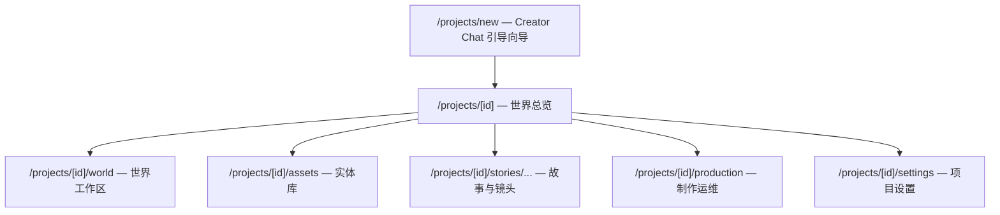
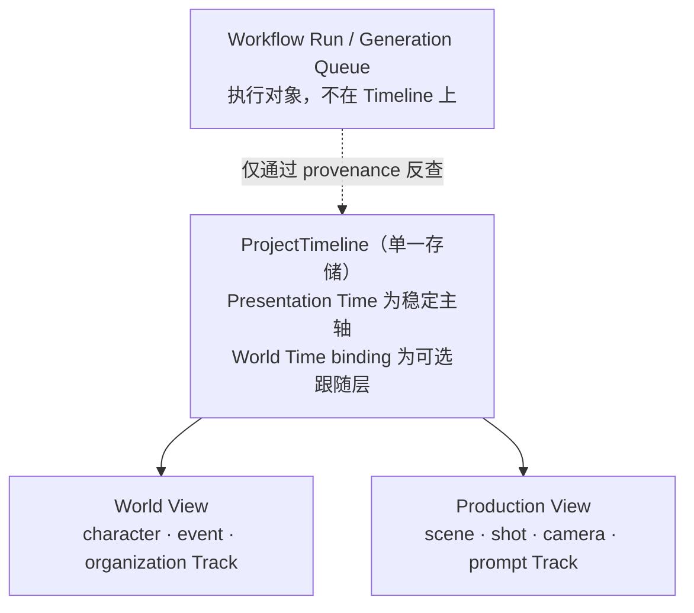

# UI Information Architecture

> Zivith 界面信息架构 — 从生成优先转向世界优先
>
> Version: 1.0
>
> Status: Draft — 落地任务见 [Next Tasks](../planning/Next-Tasks.md) Track K
>
> Last Updated: 2026-07-31
>
> Related: [Product-Positioning.md](Product-Positioning.md), [Design-Philosophy.md](Design-Philosophy.md), [Core-Domain-Model.md](../domain/Core-Domain-Model.md), [AI Creative IDE RFC](../architecture/rfc/AI-Creative-IDE-RFC.md), [ADR-0007](../architecture/adr/0007-preserve-current-state-with-immutable-creative-history.md), [ADR-0010](../architecture/adr/0010-creator-chat-is-a-guided-world-creation-wizard.md)

---

## 1. 目的与判据

[ADR-0008](../architecture/adr/0008-zivith-is-an-ai-understandable-ip-creation-system.md) 把 Zivith 定位为 AI 可理解的 IP 创作系统，但界面还停留在上一个定位。本文档定义界面应该长成什么样，以及怎么迁移过去。

单一判据：

> 打开一个 `Project`，最先看到的应该是**这个世界**，而不是生成这个世界所用的机器。

本文档只管信息架构——有哪些界面区域、它们承载什么、彼此如何导航。视觉设计、组件样式、交互细节不在范围内。

---

## 2. 现状盘点（2026-07-31）

以下是代码事实，不是评价。

### 2.1 现有路由

```
/                                        → redirect('/projects')，无落地页
/login  ·  /register                     → 认证
/projects                                → 项目卡片列表（CRUD）
/projects/[projectId]                    → 项目主页
/projects/[projectId]/assets             → 资产库（角色 / 地点按钮切换，非 URL tab）
/projects/[projectId]/assets/[assetId]   → 资产详情（参考图、设定表、形象变体）
/projects/[projectId]/stories/[storyId]  → 故事编辑器（Scene CRUD 内嵌于此）
      …/scenes/[sceneId]/shots/[shotId]  → 镜头编辑器
```

`Scene` 没有独立页面，内嵌在 Story 编辑器中。侧栏导航只有三项：项目、故事、角色与场景。

### 2.2 项目主页的当前构成

从上到下依次是：

1. `ProviderPanel` — 模型提供商与模型选择
2. `UsageSummaryCard` — API 用量统计
3. `WorkflowPanel` — Story-to-Video 工作流与各阶段评审（约 1700 行，系统中最大的组件）
4. `GenerationQueuePanel` — 视频生成任务队列
5. 故事卡片列表

### 2.3 诊断

**信息架构是生成优先的。** 打开一个项目，前两屏是模型选择器和用量统计——它们是运维工具，不是创作内容，却占据了最显眼的位置。

**世界完全不可见。** 没有任何界面回答「这个世界现在处于什么阶段」。资产页只有角色和地点两个平铺列表，没有关系、没有事件、没有时间线、没有角色的状态演化。`Character` 的 `EntityRevision` 历史在 Track H 已经开始写入，但界面上无处呈现。

**导航层级与领域层级不一致。** 侧栏把「角色与场景」并列为一个入口，而领域模型里 `Character`（世界实体）与 `Scene`（叙事单元）分属两层；这个命名本身就在强化上一节术语映射要消除的混淆。

---

## 3. 目标信息架构

### 3.1 两层对应两组界面



界面分组直接映射领域的两层：**世界层**由世界总览、世界工作区、实体库承载；**表达层**由故事与镜头承载；**运维**从内容区剥离，单独成区。

### 3.2 路由映射

| 目标路由 | 状态 | 承载 |
|----------|------|------|
| `/projects/new` | 新增 | Creator Chat 引导向导 |
| `/projects/[id]` | **重构** | 世界总览（取代现有的面板堆叠） |
| `/projects/[id]/world` | 新增 | 世界工作区：Explorer + Timeline + Inspector |
| `/projects/[id]/assets` | 保留 | 实体库，导航名改为「实体库」 |
| `/projects/[id]/assets/[assetId]` | 保留 | 实体详情，增补 State 历史与关系 |
| `/projects/[id]/stories/...` | 保留不动 | 表达层，现有路由全部有效 |
| `/projects/[id]/production` | 新增 | `WorkflowPanel` + `GenerationQueuePanel` 迁入 |
| `/projects/[id]/settings` | 新增 | `ProviderPanel` + `UsageSummaryCard` 迁入 |

现有路由**一个都不删除**。这是 [AI Creative IDE RFC](../architecture/rfc/AI-Creative-IDE-RFC.md) 第 9 节迁移规则的要求：在替代界面达到功能对等之前，既有编辑器保持可用。

### 3.3 侧栏导航

| 现在 | 目标 |
|------|------|
| 项目 | 世界总览 |
| 故事 | 世界工作区 |
| 角色与场景 | 实体库 |
| — | 故事 |
| — | 制作 |
| — | 设置 |

「角色与场景」这个名字要改掉。`Scene` 是叙事单元，属于故事；实体库里放的是 `Character` 与 `Location`。

---

## 4. 世界总览（项目主页）

回答一个问题：**这个世界现在处于什么阶段。**

建议包含五块，按重要性排序：

1. **世界状态摘要** — 世界观要点、当前所处阶段、`Timeline` 的最新位置
2. **角色现状** — 主要 `Character` 及其当前 State，而不只是一张参考图
3. **最近事件** — 最近的 `WorldEvent` 及其影响到的实体（依赖 Track I）
4. **待处理评审** — 卡在 gate 上的项，直接跳转到对应界面
5. **最近产出** — 最近的 `Output`，作为世界的产出而非页面主体

`ProviderPanel`、`UsageSummaryCard`、`GenerationQueuePanel` 全部撤出此页。它们不消失，只是搬到 `/production` 与 `/settings`——运维工具不该占据内容区的第一屏。

---

## 5. 世界工作区

### 5.1 窗格布局

[AI Creative IDE RFC](../architecture/rfc/AI-Creative-IDE-RFC.md) 第 5 节定义了四窗格。其中 Director Console 属于该 RFC 的 Slice C，且受 [Director Copilot RFC](../architecture/rfc/Director-Copilot-RFC.md) 管辖、排期在 Phase 3+。因此 **Track K 只做三窗格，并为控制台预留槽位**：

```text
┌──────────────┬───────────────────────────────┬────────────────┐
│ Project      │ Timeline                      │ Entity         │
│ Explorer     │ World View / Production View  │ Inspector      │
│              ├───────────────────────────────┤                │
│              │ （Director Console 槽位，     │                │
│              │   Phase 3+ 填充）             │                │
└──────────────┴───────────────────────────────┴────────────────┘
```

三窗格的职责沿用 RFC 定义，不重复：Explorer 承载层级与实体集合并驱动选择，Inspector 显示当前 State、revision 历史与引用关系，Timeline 见下节。

### 5.2 World View 与 Production View

**这是一条 Timeline 的两个视图，不是两条时间线。**



界面上是一个视图切换器；数据上是同一个 `GET /projects/{pid}/timeline` 的不同 `view` 参数与 Track 过滤。

这样处理的原因，记录下来以免日后重提：**独立的第二条世界时间轴要求世界编年可全局排序**，而 [ADR-0007](../architecture/adr/0007-preserve-current-state-with-immutable-creative-history.md) 的 trade-off 表里被明确放弃的正是这一项——虚构世界有自定义历法、模糊时段与平行世界，`entity-state-timeline-track.md` 的投影规则要求平行世界不得强行合并为单一序列。两条持久化时间线还会带来同步机制、不一致时以谁为准、以及让 Skill 层获得状态（违反 [ADR-0009](../architecture/adr/0009-skill-is-a-capability-layer-not-a-domain-entity.md)）这三个新问题。双视图拿到了同样的产品收益，且不产生任何一个。

**生成任务不上 Timeline。** Workflow run 与队列任务是执行对象，它们的时间是执行时间，与作品时间、世界时间是三种不同的时间。它们留在 `/production`，通过 provenance 与 Timeline 上的 `Output` 互相反查。

### 5.3 Timeline 的界面约束

以下每条都是 RFC 第 10 节的验收条件，界面不得违反：

- Presentation 顺序在视觉上必须明显是主轴，World Time 偏离必须无歧义可见
- 拖动 Item 只提交 Timeline command，**不得**隐式修改 Entity State
- 固定 revision 的 Item 与跟随当前的 Item 必须有可见区分
- Project 自定义的时间维度值对核心 UI 保持不透明，除非该 Project 提供了渲染器

---

## 6. Creator Chat 的落点

**路由：`/projects/new`。** 新建项目的默认路径走向导，而不是现在的空表单。

**它有终点。** 引导完成后跳转到 `/projects/[id]` 世界总览，用户在结构化工作区继续创作。它**不在侧栏常驻**，不是一个 tab，不是可以随时回去接着聊的地方。

这是 [ADR-0010](../architecture/adr/0010-creator-chat-is-a-guided-world-creation-wizard.md) 围栏在界面上的具体形态。相应的，界面实现必须满足：向导产出的每个实体都以 `draft` 状态呈现且可编辑可拒绝；对话记录不作为创作产物展示或导出；不提供任何跳过评审的路径。

**它不是 Director Copilot。** 后者是项目内常驻的咨询侧栏，面向已经存在的世界，排期 Phase 3+，scope 由其自身 RFC 管辖，不因本文档而放宽。

---

## 7. 非目标

- 不删除任何现有路由——替代界面达到功能对等前，既有编辑器是回退路径
- 不做 Director Console（Slice C / Phase 3+，槽位预留但不填充）
- 不做节点画布（宪法 D3）
- 不做非线性剪辑时间轴（宪法 D4）——语义 Track 不是 NLE 轨道
- 不做常驻通用聊天面（ADR-0010 tripwire）
- 不在 Track K 内新增任何领域实体——世界实体由 Track I 提供，本轨只负责呈现

---

## 8. 迁移分期（Track K）

| 阶段 | 内容 | 依赖 |
|------|------|------|
| **K1** | 项目主页重构为世界总览；`ProviderPanel` / `UsageSummaryCard` 迁至 `/settings`，`WorkflowPanel` / `GenerationQueuePanel` 迁至 `/production`；侧栏导航更名与扩充 | **无** — 现在就能做 |
| **K2** | `/world` 工作区，对齐 IDE RFC Slice A：Explorer + Inspector + 只读 Presentation Timeline，仅 Scene / Character / Shot Track | Track H **H4** |
| **K3** | Creator Chat 路由 `/projects/new`，产出 `draft` 实体并跳转世界总览 | Track J |
| **K4** | World View / Production View 切换；`WorldEvent` 与 Relationship 上 Timeline | Track I |

K1 不依赖任何在途工作，可以立刻开始，且它单独就能解决「打开项目先看到模型选择器」这个最刺眼的问题。K2 之后的每一步都跟着对应的能力供给走。

---

## 9. 继承的约束

本文档不放宽以下任何一条：

- **P3 核心无头** — 界面上的每个操作都必须有对应的 API 命令，不存在只在 UI 里能做的事
- **P6 人类权威** — 所有 mandatory gate 在新界面中原样保留，`WorkflowPanel` 迁移到 `/production` 不改变其评审职责
- **Simple by Default** — 三窗格工作区可折叠，默认打开聚焦视图；新用户从向导进入，不直接面对工作区
